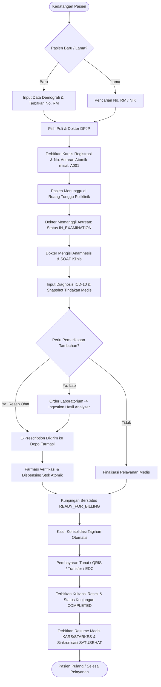

# SIMRS Rawat Jalan Terintegrasi

**PT Inova Medika Solusindo**  
*Sistem Informasi Manajemen Rumah Sakit (SIMRS) Rawat Jalan Terintegrasi Standar Nasional & Akreditasi KARS/STARKES*

---

## 🔄 Alur Pelayanan Pasien (Patient Journey Flowchart)



---

## 🗄️ Database & Entity-Relationship Diagram (ERD)

Struktur database mencakup **31 tabel relasional terstandarisasi** dengan referensi integritas foreign key, partial index, dan tabel log audit.

Diagram lengkap dan kamus data atribut dapat dilihat di:  
📄 **[Dokumentasi Lengkap ERD & Kamus Data (docs/ERD.md)](docs/ERD.md)**

```text
Struktur Domain Tabel Utama:
├── Keamanan & User: roles, users, audit_logs
├── Sarana & Dokter: polyclinics, medical_staff, doctor_schedules, queue_counters
├── Pasien & Kunjungan: patients, visits
├── EMR & Klinis: medical_records, diagnoses, visit_diagnoses, medical_procedures, visit_procedures
├── Farmasi: medicines, medicine_stocks, stock_movements, prescriptions, prescription_items, medicine_dispensations
├── Laboratorium: lab_tests, lab_orders, lab_order_items, lab_results
├── Kasir & Billing: invoices, invoice_items, payments, invoice_adjustments
└── Integrasi: satusehat_logs, bpjs_sep
```

---

## 🚀 Panduan Setup & Menjalankan Sistem

### Prasyarat Sistem (*System Requirements*)
- **PHP**: Versi 8.2 atau 8.4 (ekstensi: `pdo_pgsql`, `mbstring`, `openssl`, `json`)
- **Composer**: Versi 2.x
- **Node.js**: Versi 20.x atau 22 LTS & **npm**
- **PostgreSQL**: Versi 15 s/d 17
- **Git**

---

### Cara 1: Menjalankan Seluruh Sistem Sekaligus (1 Perintah)

Sistem telah dilengkapi skrip orkestrasi otomatis. Cukup jalankan perintah berikut di root folder project:

```bash
# Memberikan izin eksekusi skrip
chmod +x start_all.sh

# Menjalankan seluruh stack (Database, Core Backend, Node.js Gateway, Frontend SPA)
./start_all.sh
```
*Atau menggunakan Makefile:*
```bash
make start
```

Skrip ini akan secara otomatis:
1. Memeriksa ketersediaan port (5432, 8000, 3001, 5173).
2. Memverifikasi koneksi database PostgreSQL `simrs_db`.
3. Menjalankan Core Backend PHP pada `http://localhost:8000`.
4. Menjalankan Supporting Backend Node.js pada `http://localhost:3001`.
5. Menjalankan Frontend React SPA pada `http://localhost:5173`.

---

### Cara 2: Menjalankan Secara Manual Step-by-Step

#### 1. Inisialisasi Database PostgreSQL
Masuk ke terminal PostgreSQL dan buat database serta user:
```bash
# Masuk ke PostgreSQL
psql -U postgres

# Buat database dan user simrs
CREATE DATABASE simrs_db;
CREATE USER simrs_core WITH ENCRYPTED PASSWORD 'SimrsCoreSecret2026!';
GRANT ALL PRIVILEGES ON DATABASE simrs_db TO simrs_core;
\q
```

Jalankan skrip skema dan seed data master:
```bash
# Import DDL 31 Tabel
psql -U simrs_core -d simrs_db -f database/schema.sql

# Import Data Master & Dummy Realistis (Poli, Dokter, Obat, Lab, ICD-10)
psql -U simrs_core -d simrs_db -f database/seeds.sql
```

#### 2. Menjalankan Core Backend (PHP Yii REST)
```bash
# Install dependensi PHP
composer install

# Jalankan server lokal PHP
php -S 127.0.0.1:8000 -t public
```
*API Core Backend aktif di: `http://localhost:8000`*

#### 3. Menjalankan Supporting Backend (Node.js Express)
```bash
cd backend-node
npm install
npm run dev
```
*API Node.js Gateway aktif di: `http://localhost:3001`*

#### 4. Menjalankan Frontend React SPA
```bash
cd frontend-react
npm install
npm run dev
```
*Aplikasi Web SIMRS aktif di: `http://localhost:5173`*

---

## 👥 Kredensial Akun Pengujian Bawaan

| Role Pengguna | Username | Password | Deskripsi Akses |
| :--- | :--- | :--- | :--- |
| **Dokter Spesialis** | `dr.budi` | `Password123!` | Akses Antrean Poli, Pemeriksaan EMR/SOAP, Resep, Order Lab |
| **Petugas Kasir** | `kasir.maya` | `Password123!` | Akses Kasir Rawat Jalan, Pelunasan Tagihan, Cetak Kuitansi |
| **Petugas Farmasi** | `farmasi.ahmad`| `Password123!` | Akses Depo Farmasi, Dispensing Obat, Stok Persediaan |
| **Administrator** | `admin` | `Password123!` | Akses Penuh: Master Data CRUD, Pengguna, Audit Trail, Laporan |

---

## 📮 Dokumentasi API & Postman Collection

Berkas Postman Collection v2.1 telah disediakan secara lengkap di repositori:
- **Koleksi API**: [postman_collection.json](postman_collection.json) atau [postman/SIMRS_Collection.json](postman/SIMRS_Collection.json)
- **Environment**: [postman_environment.json](postman_environment.json) atau [postman/SIMRS_Environment.json](postman/SIMRS_Environment.json)

### Cara Import ke Postman:
1. Buka aplikasi **Postman**.
2. Klik tombol **Import** di sudut kiri atas.
3. Pilih berkas `postman_collection.json` dan `postman_environment.json`.
4. Pilih environment **SIMRS Local Environment**.
5. Jalankan request `1. Authentication -> Login (dr.budi - DOCTOR)` untuk mendapatkan JWT Token otomatis. Seluruh request lainnya telah terkonfigurasi dengan variabel `{{jwt_token}}`.
