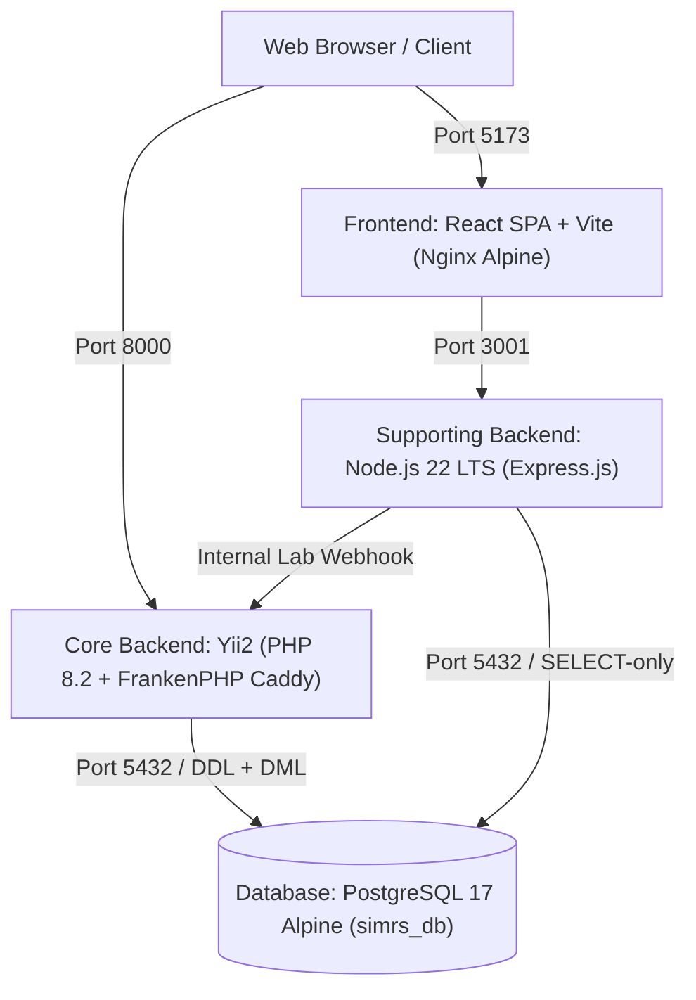

# Panduan Deployment Multi-Container Docker
**SIMRS Rawat Jalan Terintegrasi — PT Inova Medika Solusindo**

---

## 1. Arsitektur Multi-Container

Aplikasi SIMRS dirancang untuk berjalan dalam lingkungan kontainer terisolasi dengan performa tinggi menggunakan Docker Compose:



---

## 2. Rincian Layanan (Services)

| Service Name | Container Name | Base Image | Port Mapping | Fungsi & Akses |
|---|---|---|---|---|
| **postgres** | `simrs-postgres` | `postgres:17-alpine` | `5432:5432` | Basis data transaksional utama (`simrs_db`), auto-init `01-schema.sql` dan `02-seeds.sql`. |
| **core-backend** | `simrs-yii-backend` | `frankenphp:1-php8.2-bookworm` | `8000:80` | REST API Server utama SIMRS (Single Source of Truth, ACID transactions, RBAC, SATUSEHAT FHIR R4). |
| **supporting-backend** | `simrs-node-supporting` | `node:22-alpine` | `3001:3001` | Microservice integrasi analyzer laboratorium dan agregator dashboard eksekutif (read-only). |
| **frontend** | `simrs-react-frontend` | `nginx:alpine` (Multi-stage) | `5173:80` | Client SPA antarmuka pengguna berbasis peran (Pendaftaran, Antrean, Dokter, Farmasi, Kasir, Dashboard). |

---

## 3. Langkah-Langkah Deployment Cepat (Quick Start)

### Prasyarat
- Docker Engine versi 24.0+
- Docker Compose versi 2.20+
- Port `5432`, `8000`, `3001`, dan `5173` tersedia di host.

### Langkah 1: Kloning & Pindah Direktori
```bash
cd /Users/macbookair/Documents/website/SIMRS/SIMRS
```

### Langkah 2: Build Seluruh Image Kontainer
```bash
docker compose build
```

### Langkah 3: Jalankan Seluruh Kontainer
```bash
docker compose up -d
```

### Langkah 4: Verifikasi Status Kontainer
```bash
docker compose ps
```
Pastikan seluruh 4 kontainer berstatus `healthy` atau `running`.

---

## 4. Pengujian Akses Layanan

Setelah seluruh kontainer aktif, akses layanan berikut:

1. **Frontend Web SIMRS:**  
   Buka peramban ke: `http://localhost:5173`  
   Akun Pengujian Cepat:
   - Petugas Pendaftaran: `staff.pendaftaran` / `Password123!`
   - Dokter Poli: `dr.budi` / `Password123!`
   - Petugas Farmasi: `apt.siti` / `Password123!`
   - Kasir: `kasir.rina` / `Password123!`
   - Manajemen/Direksi: `admin` / `Password123!`

2. **Core Backend Yii2 REST API:**  
   Buka peramban ke: `http://localhost:8000/api/v1/polyclinics`  
   Respon JSON: Daftar 6 poliklinik aktif.

3. **Supporting Backend Node.js API:**  
   Buka peramban ke: `http://localhost:3001/api/v1/health`  
   Respon JSON: `{"status":"OK","timestamp":"..."}`

4. **Layar Display TV Antrean Ruang Tunggu:**  
   Buka peramban ke: `http://localhost:5173/tv-queue`

---

## 5. Penghentian & Pembersihan

Untuk menghentikan kontainer:
```bash
docker compose down
```

Untuk menghentikan dan mereset volume data database:
```bash
docker compose down -v
```
