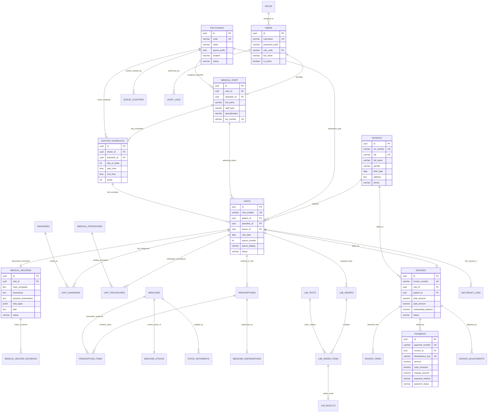

# Entity-Relationship Diagram (ERD) & Kamus Data SIMRS
**SIMRS Rawat Jalan Terintegrasi — PT Inova Medika Solusindo**

---

## 1. Diagram Relasi Entitas (Mermaid ERD)

---

## 2. Kamus Data & Spesifikasi Tabel (Data Dictionary)

### A. Domain Keamanan & Pengguna (RBAC)
1. **`roles`**: Master peran pengguna sistem (`ADMIN`, `DOCTOR`, `NURSE`, `PHARMACIST`, `CASHIER`).
2. **`users`**: Akun pengguna terotentikasi bcrypt dengan kaitan peran RBAC dan audit trail.
3. **`audit_logs`**: Log audit tak terhapuskan (*append-only / immutable*) sesuai standar Permenkes No. 24/2022 tentang Rekam Medis.

### B. Domain Master Data Klinis & Sarana
4. **`polyclinics`**: Unit poliklinik rawat jalan (Penyakit Dalam, Anak, Gigi, Kandungan, Mata, Bedah Umum) beserta prefix antrean (`A`, `B`, `C`, `D`, `E`, `F`).
5. **`medical_staff`**: Data dokter spesialis dan staf klinis dengan No. SIP resmi Kemenkes.
6. **`doctor_schedules`**: Jadwal praktik dokter (hari 1–7, jam mulai–selesai, dan kuota pasien).
7. **`patients`**: Identitas demografis pasien dengan Nomor Rekam Medis otomatis (`RM-YYYYMM-XXXXX`) dan NIK 16 digit terindeks unik.

### C. Domain Pendaftaran & Manajemen Antrean
8. **`visits`**: Kunjungan rawat jalan pasien dengan siklus status `REGISTERED` ➔ `WAITING` ➔ `IN_EXAMINATION` ➔ `WAITING_LAB` / `WAITING_PHARMACY` ➔ `READY_FOR_BILLING` ➔ `COMPLETED`.
   - Dilindungi *PostgreSQL Partial Unique Index*: `CREATE UNIQUE INDEX visits_active_daily_unique_idx ON visits(patient_id, polyclinic_id, visit_date) WHERE status NOT IN ('COMPLETED', 'CANCELLED')`.
9. **`queue_counters`**: Pencatat urutan counter nomor antrean harian per poliklinik secara atomik.

### D. Domain Rekam Medis Elektronik (RME / EMR)
10. **`medical_records`**: Catatan medis SOAP (Subjektif, Objektif, Asesmen, Plan) dengan tanda-tanda vital format JSONB.
11. **`diagnoses`**: Katalog diagnosis penyakit standar WHO ICD-10 (Kode, Deskripsi Bahasa Indonesia & Inggris).
12. **`visit_diagnoses`**: Diagnosis pasien pada kunjungan (ditandai `PRIMARY` atau `SECONDARY`).
13. **`medical_procedures`**: Katalog master tindakan klinis dan tarif dasar.
14. **`visit_procedures`**: Tindakan medis yang diberikan kepada pasien dengan **snapshot tarif terjamin** (`snapshot_price` bersifat *immutable* dari perubahan master harga di kemudian hari).

### E. Domain Farmasi & Pengendalian Persediaan
15. **`medicines`**: Katalog obat, sediaan, dosis, dan batas minimum stok peringatan.
16. **`medicine_stocks`**: Stok obat terkini di depo farmasi rawat jalan.
17. **`stock_movements`**: Kartu stok elektronik yang mencatat riwayat mutasi masuk/keluar secara atomik.
18. **`prescriptions`**: Lembar resep elektronik yang diterbitkan oleh dokter DPJP.
19. **`prescription_items`**: Rincian obat, aturan pakai, dosis, dan kuantitas.
20. **`medicine_dispensations`**: Verifikasi penyerahan obat oleh apoteker dengan row-level lock `FOR UPDATE` untuk mencegah *overselling*.

### F. Domain Laboratorium & Integrasi Alat
21. **`lab_tests`**: Katalog pemeriksaan laboratorium (Darah Lengkap, Glukosa, Kolesterol, dsb.) beserta nilai rujukan.
22. **`lab_orders`**: Formulir permintaan laboratorium oleh dokter DPJP.
23. **`lab_order_items`**: Parameter uji yang dipesan dalam satu order laboratorium.
24. **`lab_results`**: Hasil pembacaan alat analyzer yang masuk via Node.js Gateway dengan proteksi `X-Internal-Secret` dan `idempotency_key`.

### G. Domain Kasir, Billing & Penyesuaian Tagihan
25. **`invoices`**: Konsolidasi seluruh pos biaya pasien (karcis registrasi, tindakan medis, farmasi, lab) dengan kalkulasi otomatis `total_amount`, `paid_amount`, dan `outstanding_balance`.
26. **`invoice_items`**: Rincian snapshot per pos pelayanan yang tercetak di lembar kuitansi.
27. **`payments`**: Transaksi pembayaran kasir (Metode: `CASH`, `QRIS`, `DEBIT_CARD`, `BANK_TRANSFER`).
    - Mendukung `cash_received` (uang tunai diserahkan) dan `change_amount` (uang kembalian).
    - Dilindungi oleh constraint `idempotency_key UNIQUE` untuk menjamin *zero double billing*.
28. **`invoice_adjustments`**: Riwayat penyesuaian/diskon tagihan (`ADDITION`, `DEDUCTION`, `CANCELLATION`) dengan alasan wajib dan jejak audit supervisor kasir.

### H. Domain Integrasi Nasional
29. **`satusehat_logs`**: Log sinkronisasi FHIR R4 Kemenkes RI (Encounter ID, Condition ID, status kirim).
30. **`bpjs_sep`**: Rekam penerbitan Surat Eligibilitas Peserta (SEP) terintegrasi BPJS VClaim.

---

## 3. Aturan Integritas & Konkurensi Sistem
- **ACID Transactions**: Setiap mutasi stok obat dan pembayaran kasir dibungkus dalam blok `BEGIN ... COMMIT` dengan penanganan rollback otomatis pada kegagalan.
- **Pessimistic Row Locking (`FOR UPDATE`)**: Diterapkan saat pelunasan invoice dan dispensing obat untuk mencegah pembacaan data kadaluarsa (*stale reads*).
- **Audit Trail Immutability**: Seluruh operasi penulisan pada data sensitif pasien dicatat otomatis ke tabel `audit_logs` tanpa opsi modifikasi/penghapusan.
