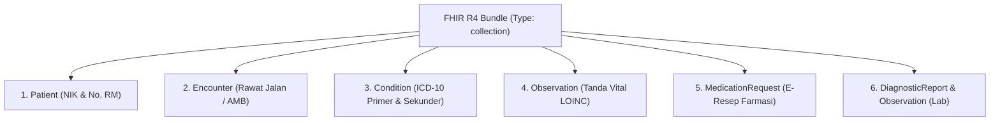

# Integrasi SATUSEHAT Kemenkes RI — Spesifikasi HL7 FHIR R4
**SIMRS Rawat Jalan Terintegrasi — PT Inova Medika Solusindo**  
*Kepatuhan Terhadap Permenkes No. 24 Tahun 2022 tentang Rekam Medis Elektronik (RME)*

---

## 1. Ringkasan Eksekutif

Sesuai amanat **Peraturan Menteri Kesehatan Republik Indonesia (Permenkes) No. 24 Tahun 2022**, seluruh Fasilitas Pelayanan Kesehatan (Fasyankes) di Indonesia wajib menyelenggarakan Rekam Medis Elektronik (RME) yang terintegrasi dengan platform **SATUSEHAT Kemenkes RI**.

Aplikasi **SIMRS Rawat Jalan Terintegrasi** telah dilengkapi modul generator dan sinkronisasi **HL7 FHIR Release 4 (R4)** secara natif pada core backend Yii2 (`App\Services\SatuSehatService`), menyediakan endpoint REST API untuk ekstraksi FHIR Bundle dan transmisi tersinkronisasi.

---

## 2. Pemetaan Resource FHIR R4 (Resource Mapping)

Setiap kunjungan rawat jalan (`visits`) yang telah memiliki rekam medis (`medical_records`), diagnosis (`visit_diagnoses`), tindakan (`visit_procedures`), resep (`prescriptions`), dan hasil laboratorium (`lab_results`) dikonversi ke dalam sebuah **FHIR R4 Bundle** bertipe `collection`:



### Detail Pemetaan per Resource:

| Resource FHIR | Standar Terminologi / Kode | Deskripsi & Atribut Pemetaan |
|---|---|---|
| **Patient** | NIK (`https://fhir.kemkes.go.id/id/nik`), No. RM | Identitas kependudukan, nama resmi, tanggal lahir, jenis kelamin, alamat, dan nomor HP. |
| **Encounter** | `http://terminology.hl7.org/CodeSystem/v3-ActCode` (`AMB`) | Pelayanan Rawat Jalan (*Ambulatory*), periode waktu pelayanan, referensi dokter DPJP (*Practitioner*), dan referensi organisasi Fasyankes (*Organization*). |
| **Condition** | ICD-10 (`http://hl7.org/fhir/sid/icd-10`) | Diagnosis kerja dan diagnosis akhir, dibedakan atas status Primer (`PRIMARY`) dan Sekunder (`SECONDARY`), dengan `clinicalStatus: active` dan `verificationStatus: confirmed`. |
| **Observation (Vitals)** | LOINC (`http://loinc.org`) | • Tekanan Darah Sistolik (`8480-6`) & Diastolik (`8462-4`)<br>• Frekuensi Nadi (`8867-4`)<br>• Laju Pernapasan (`9279-1`)<br>• Suhu Tubuh (`8310-5`)<br>• Berat Badan (`29463-7`) & Tinggi Badan (`8302-2`) |
| **MedicationRequest** | KFA (Kamus Farmasi dan Alkes Kemenkes) | Nomor resep, identitas obat, dosis, frekuensi penggunaan, rute konsumsi (Oral), dan jumlah kuantitas yang diserahkan. |
| **DiagnosticReport** | LOINC (`http://loinc.org`) | Paket pemeriksaan laboratorium patologi klinik beserta rincian parameter observasi, nilai hasil numerik, satuan (*unit*), nilai rujukan normal, dan *interpretation flag* (H/L/N). |

---

## 3. Spesifikasi API Endpoint SATUSEHAT

### 1. Ekstraksi FHIR R4 Bundle
- **Method:** `GET`
- **Path:** `/api/v1/visits/{id}/fhir-bundle`
- **Header:** `Authorization: Bearer <token>`
- **Response Format:** Valid JSON HL7 FHIR R4 Bundle.

Contoh Cuplikan Respon:
```json
{
  "success": true,
  "message": "FHIR R4 Bundle berhasil dibentuk.",
  "data": {
    "resourceType": "Bundle",
    "id": "bundle-satusehat-2e353d0d-ae05-4763-8fa2-7f0c25648a8c",
    "identifier": {
      "system": "https://fhir.kemkes.go.id/bundle",
      "value": "BDL-20261122-REG-20261122-0003"
    },
    "type": "collection",
    "total": 6,
    "entry": [
      {
        "fullUrl": "urn:uuid:patient-...",
        "resource": {
          "resourceType": "Patient",
          "identifier": [
            { "system": "https://fhir.kemkes.go.id/id/nik", "value": "320101199001010001" }
          ],
          "name": [{ "text": "Budi Santoso" }]
        }
      },
      {
        "fullUrl": "urn:uuid:encounter-...",
        "resource": {
          "resourceType": "Encounter",
          "class": { "code": "AMB", "display": "ambulatory" },
          "status": "finished"
        }
      }
    ]
  }
}
```

### 2. Transmisi & Sinkronisasi ke SATUSEHAT
- **Method:** `POST`
- **Path:** `/api/v1/visits/{id}/satusehat-sync`
- **Header:** `Authorization: Bearer <token>`
- **Perilaku:** Membentuk bundle, melakukan simulasi integrasi TLS/OAuth2 ke gateway SATUSEHAT, mencatat audit log ke tabel `satusehat_logs`, dan mengembalikan IHS Resource IDs.

### 3. Riwayat Audit Transmisi SATUSEHAT
- **Method:** `GET`
- **Path:** `/api/v1/visits/{id}/satusehat-logs`
- **Header:** `Authorization: Bearer <token>`
- **Response:** Daftar riwayat transmisi, timestamp, status (`SYNCED`), dan identifikasi IHS.

---

## 4. Antarmuka Pengguna (Frontend React)

1. **Tombol "SATUSEHAT FHIR" di Modul Dokter (`DoctorExaminationPage`):**  
   Dokter pemeriksa dapat langsung melihat pratinjau FHIR Bundle JSON secara real-time dan melakukan pengiriman 1-klik ke SATUSEHAT.
2. **Tombol "SATUSEHAT FHIR" di Riwayat Pasien (`PatientHistoryPage`):**  
   Petugas rekam medis dapat mengaudit status kelengkapan data longitudinal pasien dan memvalidasi riwayat transmisi SATUSEHAT.
3. **Modal Penampil Interaktif (`SatuSehatModal.tsx`):**  
   Dilengkapi indikator counter resource (Patient, Encounter, Condition, Observation, MedicationRequest, DiagnosticReport), viewer kode JSON berwarna dengan tombol *Salin JSON*, serta tabel audit trail transmisi.
