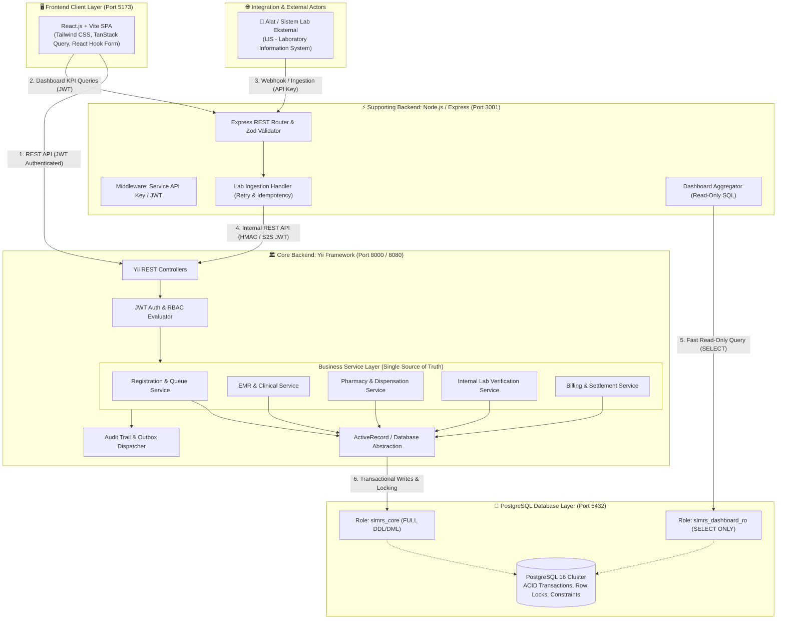
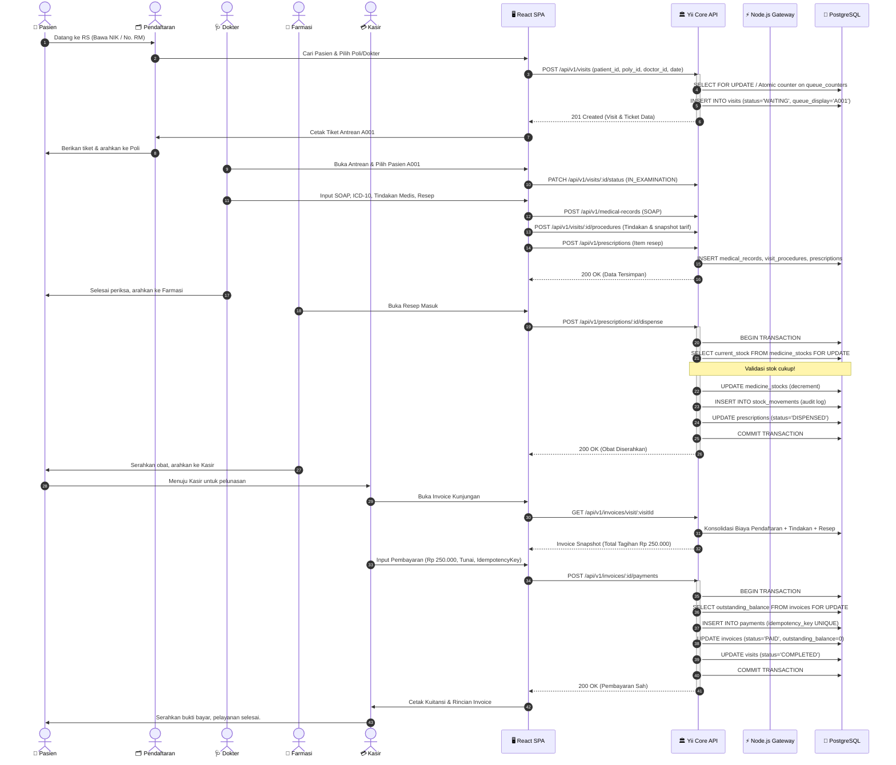

# 02 — Arsitektur Sistem, Komponen, dan Alur Kerja Terintegrasi
**SIMRS Rawat Jalan Terintegrasi — PT Inova Medika Solusindo**

---

## 1. Desain Arsitektur Keseluruhan

Sistem menggunakan pendekatan **Modular Monolith pada Yii Framework** yang dipadukan dengan **Microservice / Supporting Service berbasis Node.js & Express** serta **Frontend SPA berbasis React.js + Vite**. Arsitektur ini dipilih untuk menyeimbangkan kebutuhan kecepatan pengantaran 72 jam dengan prinsip ketahanan (*resilience*), performa tinggi, dan integritas data enterprise.

### Diagram Arsitektur Tingkat Tinggi (Mermaid)



---

## 2. Segregasi Tanggung Jawab Sistem (Separation of Concerns)

### A. Core Backend — Yii Framework (PHP 8.x)
Yii bertindak sebagai **Single Source of Truth** untuk seluruh aturan domain (*business invariants*) dan transaksi keuangan/medis:
1. **Otorisasi & Keamanan:** Pengelolaan otentikasi JWT, hashing password (Argon2id/Bcrypt), dan verifikasi peran via Yii RBAC.
2. **Master Data & Pendaftaran:** Validasi kuota dokter, pengecekan jadwal praktik, alokasi nomor antrean atomik, dan pencegahan duplikasi kunjungan.
3. **Pemeriksaan Klinis & RME:** Validasi data SOAP, kode ICD-10, serta pencatatan tindakan medis dengan snapshot tarif.
4. **Farmasi & Persediaan:** Penguncian baris (*row-level locking*), validasi ketersediaan stok, pemotongan stok pada penyerahan obat, dan kartu stok persediaan (*stock_movements*).
5. **Billing & Kasir:** Konsolidasi otomatis tagihan komponen pendaftaran, tindakan, obat, dan lab; pembuatan snapshot `invoice_items`; proses pembayaran dengan verifikasi idempotency key.
6. **Integritas Database:** Membuka dan mengontrol blok transaksi (`$transaction = $db->beginTransaction()`), commit, dan rollback.

### B. Supporting Service — Node.js (Express.js)
Node.js berfokus pada dua area pendukung yang membutuhkan I/O cepat dan isolasi dari beban transaksi utama:
1. **Lab Integration Gateway:**
   - Menerima payload hasil uji dari sistem laboratorium eksternal via webhook (`POST /api/v1/integrations/lab-results`).
   - Melakukan validasi struktur data menggunakan **Zod**.
   - Menyediakan layer *retry with exponential backoff* dan idempotency buffer jika Yii core sedang mengalami lonjakan beban.
   - Meneruskan data yang terverifikasi ke endpoint internal Yii (`POST /internal-api/v1/lab-results`) menggunakan Service-to-Service API Key / Shared Secret.
2. **Dashboard & Analytics API:**
   - Menyajikan endpoint analitik dan visualisasi data: statistik kunjungan harian, distribusi per poli, utilisasi obat, dan agregasi pendapatan kasir.
   - Terhubung langsung ke PostgreSQL menggunakan koneksi pool (`pg` / `Prisma`) dengan kredensial database **khusus read-only (`simrs_dashboard_ro`)** yang hanya memiliki hak `SELECT`.
   - **Aturan Tegas:** Node.js *dilarang keras* melakukan mutasi langsung (INSERT/UPDATE/DELETE) pada tabel-tabel transaksi inti SIMRS.

### C. Frontend SPA — React.js + Vite
1. **User Experience:** Antarmuka responsif dan modern menggunakan Tailwind CSS, konsisten dengan standar antarmuka administrasi rumah sakit.
2. **State & Server Caching:** Menggunakan TanStack Query untuk caching data master dan otomatisasi invalidasi antrean.
3. **Form Integrity:** Formulir medis dan billing menggunakan React Hook Form + Zod untuk validasi sebelum data dikirim ke backend.
4. **Cetak Dokumen:** Template HTML cetak khusus media `@media print` untuk tiket antrean, resume medis, kuitansi, dan rincian invoice.

---

## 3. Clean Architecture & Service Layer pada Yii Backend

Untuk mencegah controller menjadi *God Object* atau *Fat Controller*, arsitektur internal Yii diorganisasi secara berlapis:

```
src/ or backend-yii2/
├── Controllers/
│   └── Api/V1/          ➔ Menerima HTTP Request, deserialisasi payload, delegasi ke Service, return Response format
├── DTO/ / Forms/        ➔ Validasi input HTTP (rules, type casting, custom validators)
├── Services/            ➔ Business logic murni, orchestrator antar domain, manajemen database transaction
│   ├── RegistrationService.php
│   ├── MedicalRecordService.php
│   ├── PharmacyDispensationService.php
│   ├── BillingPaymentService.php
│   └── LabIntegrationService.php
├── Models/ / Entities/  ➔ Definisi tabel, relasi ActiveRecord, status constants, casting
├── Repositories/        ➔ Query khusus, locking queries (FOR UPDATE), agregasi kompleks
└── Components/          ➔ JWT Handler, RBAC Filter, Response Formatter, Audit Trail Behavior
```

---

## 4. Diagram Alur Pelayanan End-to-End (Sequence Diagram)

Berikut alur sinkronisasi lintas aktor dan komponen dari kedatangan pasien sampai pembayaran selesai:



---

## 5. Mekanisme Komunikasi Antar-Layanan (Service-to-Service Protocol)

1. **Node.js ke Yii Core (Internal API):**
   - Menggunakan protokol HTTP/REST private: `POST http://core-backend:8000/internal-api/v1/...`
   - Diproteksi menggunakan **Shared Secret HMAC Signature (`X-Internal-Signature`)** dan **Timestamp Header (`X-Timestamp`)** untuk mencegah replay attack.
   - Yii memvalidasi signature sebelum meneruskan data ke `LabIntegrationService`.
2. **Node.js ke Database PostgreSQL (Read-Only Pool):**
   - Koneksi langsung melalui TCP pool menggunakan PostgreSQL User `simrs_dashboard_ro`.
   - Hanya memiliki privilege `GRANT SELECT ON ALL TABLES IN SCHEMA public TO simrs_dashboard_ro;`.
   - Eksekusi query analitik berkecepatan tinggi tanpa melewati beban layer HTTP Yii.
