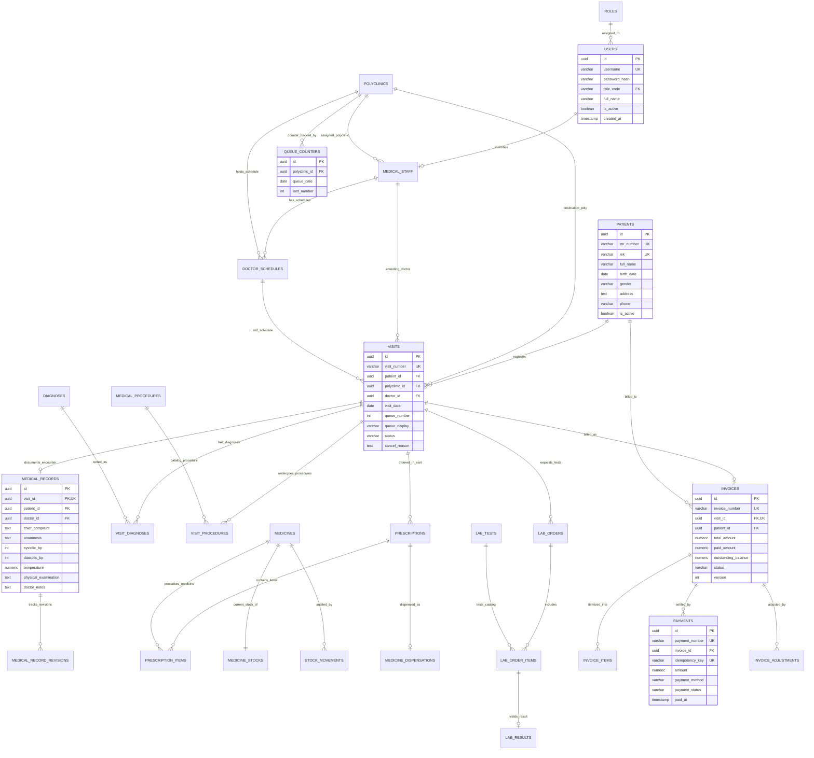

# 03 — Desain Database, Relasi, dan Diagram ERD PostgreSQL
**SIMRS Rawat Jalan Terintegrasi — PT Inova Medika Solusindo**

---

## 1. Entity-Relationship Diagram (Mermaid ERD)



---

## 2. Struktur Tabel Relasional PostgreSQL

Database dirancang memenuhi kaidah **3rd Normal Form (3NF)** dengan penggunaan tipe data yang presisi (`UUID` untuk primary key, `NUMERIC(14,2)` untuk finansial, `JSONB` untuk audit & snapshot, serta `TIMESTAMP WITH TIME ZONE`).

### 2.1 Domain Pengguna & Master Data

#### 1. `roles`
Menyimpan peran sistem SIMRS.
- `code` VARCHAR(30) PRIMARY KEY (misal: `'ADMIN'`, `'REGISTRATION'`, `'DOCTOR'`, `'PHARMACY'`, `'LABORATORY'`, `'CASHIER'`).
- `name` VARCHAR(100) NOT NULL.
- `description` TEXT.

#### 2. `users`
Akun pengguna login ke sistem.
- `id` UUID PRIMARY KEY DEFAULT gen_random_uuid().
- `username` VARCHAR(50) UNIQUE NOT NULL.
- `email` VARCHAR(100) UNIQUE NOT NULL.
- `password_hash` VARCHAR(255) NOT NULL (Argon2id/Bcrypt).
- `role_code` VARCHAR(30) NOT NULL REFERENCES roles(code).
- `full_name` VARCHAR(150) NOT NULL.
- `is_active` BOOLEAN NOT NULL DEFAULT TRUE.
- `created_at` TIMESTAMPTZ NOT NULL DEFAULT CURRENT_TIMESTAMP.
- `updated_at` TIMESTAMPTZ NOT NULL DEFAULT CURRENT_TIMESTAMP.

#### 3. `patients`
Master data pasien dengan nomor rekam medis unik.
- `id` UUID PRIMARY KEY DEFAULT gen_random_uuid().
- `mr_number` VARCHAR(20) UNIQUE NOT NULL (Format: `RM-YYYYMM-XXXXX`).
- `nik` VARCHAR(16) UNIQUE NOT NULL.
- `full_name` VARCHAR(150) NOT NULL.
- `birth_date` DATE NOT NULL.
- `gender` VARCHAR(10) NOT NULL CHECK (gender IN ('MALE', 'FEMALE')).
- `address` TEXT NOT NULL.
- `phone` VARCHAR(25) NOT NULL.
- `is_active` BOOLEAN NOT NULL DEFAULT TRUE.
- `created_at` TIMESTAMPTZ NOT NULL DEFAULT CURRENT_TIMESTAMP.
- `updated_at` TIMESTAMPTZ NOT NULL DEFAULT CURRENT_TIMESTAMP.

#### 4. `polyclinics`
Poliklinik pelayanan rawat jalan.
- `id` UUID PRIMARY KEY DEFAULT gen_random_uuid().
- `code` VARCHAR(20) UNIQUE NOT NULL (misal: `POLI-INT`, `POLI-OBG`, `POLI-ANA`).
- `name` VARCHAR(100) NOT NULL.
- `queue_prefix` VARCHAR(5) NOT NULL (misal: `A`, `B`, `C`).
- `is_active` BOOLEAN NOT NULL DEFAULT TRUE.
- `created_at` TIMESTAMPTZ NOT NULL DEFAULT CURRENT_TIMESTAMP.
- `updated_at` TIMESTAMPTZ NOT NULL DEFAULT CURRENT_TIMESTAMP.

#### 5. `medical_staff`
Data tenaga medis dokter atau perawat.
- `id` UUID PRIMARY KEY DEFAULT gen_random_uuid().
- `user_id` UUID REFERENCES users(id).
- `staff_type` VARCHAR(20) NOT NULL CHECK (staff_type IN ('DOCTOR', 'NURSE')).
- `sip_number` VARCHAR(50) UNIQUE NOT NULL.
- `full_name` VARCHAR(150) NOT NULL.
- `polyclinic_id` UUID REFERENCES polyclinics(id).
- `is_active` BOOLEAN NOT NULL DEFAULT TRUE.
- `created_at` TIMESTAMPTZ NOT NULL DEFAULT CURRENT_TIMESTAMP.
- `updated_at` TIMESTAMPTZ NOT NULL DEFAULT CURRENT_TIMESTAMP.

#### 6. `doctor_schedules`
Jadwal operasional praktik dokter per poliklinik.
- `id` UUID PRIMARY KEY DEFAULT gen_random_uuid().
- `doctor_id` UUID NOT NULL REFERENCES medical_staff(id).
- `polyclinic_id` UUID NOT NULL REFERENCES polyclinics(id).
- `day_of_week` SMALLINT NOT NULL CHECK (day_of_week BETWEEN 1 AND 7).
- `start_time` TIME NOT NULL.
- `end_time` TIME NOT NULL.
- `quota` INT NOT NULL DEFAULT 30.
- `is_active` BOOLEAN NOT NULL DEFAULT TRUE.
- `created_at` TIMESTAMPTZ NOT NULL DEFAULT CURRENT_TIMESTAMP.
- `updated_at` TIMESTAMPTZ NOT NULL DEFAULT CURRENT_TIMESTAMP.

#### 7. `medical_procedures`
Katalog tindakan medis dan tarif standar.
- `id` UUID PRIMARY KEY DEFAULT gen_random_uuid().
- `code` VARCHAR(30) UNIQUE NOT NULL.
- `name` VARCHAR(150) NOT NULL.
- `base_price` NUMERIC(14,2) NOT NULL CHECK (base_price >= 0).
- `is_active` BOOLEAN NOT NULL DEFAULT TRUE.
- `created_at` TIMESTAMPTZ NOT NULL DEFAULT CURRENT_TIMESTAMP.
- `updated_at` TIMESTAMPTZ NOT NULL DEFAULT CURRENT_TIMESTAMP.

#### 8. `medicines`
Master obat dan perbekalan farmasi.
- `id` UUID PRIMARY KEY DEFAULT gen_random_uuid().
- `code` VARCHAR(30) UNIQUE NOT NULL.
- `name` VARCHAR(150) NOT NULL.
- `generic_name` VARCHAR(150),
- `unit` VARCHAR(30) NOT NULL (Tablet, Kapsul, Botol, Ampul).
- `base_price` NUMERIC(14,2) NOT NULL CHECK (base_price >= 0).
- `is_active` BOOLEAN NOT NULL DEFAULT TRUE.
- `created_at` TIMESTAMPTZ NOT NULL DEFAULT CURRENT_TIMESTAMP.
- `updated_at` TIMESTAMPTZ NOT NULL DEFAULT CURRENT_TIMESTAMP.

---

### 2.2 Domain Pendaftaran & Antrean

#### 9. `queue_counters`
Alokasi nomor urut antrean secara terisolasi dan atomik.
- `id` UUID PRIMARY KEY DEFAULT gen_random_uuid().
- `polyclinic_id` UUID NOT NULL REFERENCES polyclinics(id),
- `queue_date` DATE NOT NULL,
- `last_number` INT NOT NULL DEFAULT 0,
- `updated_at` TIMESTAMPTZ NOT NULL DEFAULT CURRENT_TIMESTAMP,
- **CONSTRAINT:** `UNIQUE (polyclinic_id, queue_date)`

#### 10. `visits`
Kunjungan rawat jalan pasien.
- `id` UUID PRIMARY KEY DEFAULT gen_random_uuid().
- `visit_number` VARCHAR(30) UNIQUE NOT NULL (Format: `REG-YYYYMMDD-XXXXX`).
- `patient_id` UUID NOT NULL REFERENCES patients(id).
- `polyclinic_id` UUID NOT NULL REFERENCES polyclinics(id).
- `doctor_id` UUID NOT NULL REFERENCES medical_staff(id).
- `schedule_id` UUID REFERENCES doctor_schedules(id).
- `visit_date` DATE NOT NULL.
- `queue_number` INT NOT NULL.
- `queue_display` VARCHAR(10) NOT NULL (misal: `A001`).
- `status` VARCHAR(30) NOT NULL DEFAULT 'REGISTERED' CHECK (status IN ('REGISTERED', 'WAITING', 'IN_EXAMINATION', 'WAITING_LAB', 'WAITING_PHARMACY', 'READY_FOR_BILLING', 'COMPLETED', 'CANCELLED')).
- `cancel_reason` TEXT,
- `registered_by` UUID REFERENCES users(id).
- `created_at` TIMESTAMPTZ NOT NULL DEFAULT CURRENT_TIMESTAMP.
- `updated_at` TIMESTAMPTZ NOT NULL DEFAULT CURRENT_TIMESTAMP.
- **PARTIAL UNIQUE INDEX:** `CREATE UNIQUE INDEX uq_patient_poly_date ON visits (patient_id, polyclinic_id, visit_date) WHERE status NOT IN ('CANCELLED');` *(Mencegah duplikasi pendaftaran ganda)*.

---

### 2.3 Domain Rekam Medis Elektronik (RME) & Tindakan

#### 11. `medical_records`
Catatan klinis dokter per kunjungan.
- `id` UUID PRIMARY KEY DEFAULT gen_random_uuid().
- `visit_id` UUID UNIQUE NOT NULL REFERENCES visits(id).
- `patient_id` UUID NOT NULL REFERENCES patients(id).
- `doctor_id` UUID NOT NULL REFERENCES medical_staff(id).
- `chief_complaint` TEXT NOT NULL.
- `anamnesis` TEXT NOT NULL.
- `systolic_bp` INT CHECK (systolic_bp BETWEEN 40 AND 300).
- `diastolic_bp` INT CHECK (diastolic_bp BETWEEN 30 AND 200).
- `heart_rate` INT CHECK (heart_rate BETWEEN 30 AND 250).
- `respiratory_rate` INT CHECK (respiratory_rate BETWEEN 8 AND 80).
- `temperature` NUMERIC(4,1) CHECK (temperature BETWEEN 30.0 AND 45.0).
- `weight` NUMERIC(5,2),
- `height` NUMERIC(5,2),
- `physical_examination` TEXT,
- `doctor_notes` TEXT,
- `status` VARCHAR(20) NOT NULL DEFAULT 'DRAFT' CHECK (status IN ('DRAFT', 'FINALIZED')),
- `created_at` TIMESTAMPTZ NOT NULL DEFAULT CURRENT_TIMESTAMP.
- `updated_at` TIMESTAMPTZ NOT NULL DEFAULT CURRENT_TIMESTAMP.

#### 12. `medical_record_revisions`
Audit trail perubahan data medis setelah finalisasi.
- `id` UUID PRIMARY KEY DEFAULT gen_random_uuid().
- `medical_record_id` UUID NOT NULL REFERENCES medical_records(id).
- `revised_by` UUID NOT NULL REFERENCES users(id).
- `revision_reason` TEXT NOT NULL.
- `previous_data` JSONB NOT NULL.
- `created_at` TIMESTAMPTZ NOT NULL DEFAULT CURRENT_TIMESTAMP.

#### 13. `diagnoses`
Katalog kode diagnosis standar (ICD-10).
- `id` UUID PRIMARY KEY DEFAULT gen_random_uuid().
- `code` VARCHAR(20) UNIQUE NOT NULL (misal: `I10`, `E11.9`, `J00`).
- `description` TEXT NOT NULL.
- `is_active` BOOLEAN NOT NULL DEFAULT TRUE.

#### 14. `visit_diagnoses`
Diagnosis yang ditegakkan pada kunjungan.
- `id` UUID PRIMARY KEY DEFAULT gen_random_uuid().
- `visit_id` UUID NOT NULL REFERENCES visits(id).
- `diagnosis_id` UUID NOT NULL REFERENCES diagnoses(id).
- `diagnosis_type` VARCHAR(15) NOT NULL CHECK (diagnosis_type IN ('PRIMARY', 'SECONDARY')).
- `notes` TEXT.
- `created_at` TIMESTAMPTZ NOT NULL DEFAULT CURRENT_TIMESTAMP.

#### 15. `visit_procedures`
Tindakan medis yang dilakukan dokter pada kunjungan (dengan harga snapshot).
- `id` UUID PRIMARY KEY DEFAULT gen_random_uuid().
- `visit_id` UUID NOT NULL REFERENCES visits(id).
- `procedure_id` UUID NOT NULL REFERENCES medical_procedures(id).
- `doctor_id` UUID NOT NULL REFERENCES medical_staff(id).
- `snapshot_price` NUMERIC(14,2) NOT NULL CHECK (snapshot_price >= 0).
- `quantity` INT NOT NULL DEFAULT 1 CHECK (quantity > 0).
- `subtotal` NUMERIC(14,2) NOT NULL CHECK (subtotal >= 0).
- `status` VARCHAR(20) NOT NULL DEFAULT 'CONFIRMED' CHECK (status IN ('CONFIRMED', 'CANCELLED')).
- `cancel_reason` TEXT,
- `created_at` TIMESTAMPTZ NOT NULL DEFAULT CURRENT_TIMESTAMP.

---

### 2.4 Domain Farmasi & Persediaan

#### 16. `medicine_stocks`
Stok aktual per obat di depo rawat jalan.
- `id` UUID PRIMARY KEY DEFAULT gen_random_uuid().
- `medicine_id` UUID UNIQUE NOT NULL REFERENCES medicines(id).
- `current_stock` INT NOT NULL DEFAULT 0 CHECK (current_stock >= 0),
- `minimum_stock` INT NOT NULL DEFAULT 10,
- `updated_at` TIMESTAMPTZ NOT NULL DEFAULT CURRENT_TIMESTAMP.

#### 17. `stock_movements`
Kartu mutasi histori persediaan obat (Audit Trail).
- `id` UUID PRIMARY KEY DEFAULT gen_random_uuid().
- `medicine_id` UUID NOT NULL REFERENCES medicines(id).
- `reference_type` VARCHAR(30) NOT NULL CHECK (reference_type IN ('INITIAL', 'DISPENSATION', 'ADJUSTMENT', 'RESTOCK', 'CANCELLATION')).
- `reference_id` UUID,
- `quantity_change` INT NOT NULL, -- Positif untuk masuk, Negatif untuk keluar
- `stock_before` INT NOT NULL,
- `stock_after` INT NOT NULL,
- `notes` TEXT,
- `created_by` UUID REFERENCES users(id).
- `created_at` TIMESTAMPTZ NOT NULL DEFAULT CURRENT_TIMESTAMP.

#### 18. `prescriptions`
Resep obat dokter untuk kunjungan.
- `id` UUID PRIMARY KEY DEFAULT gen_random_uuid().
- `visit_id` UUID NOT NULL REFERENCES visits(id).
- `doctor_id` UUID NOT NULL REFERENCES medical_staff(id).
- `prescription_number` VARCHAR(30) UNIQUE NOT NULL (Format: `RX-YYYYMMDD-XXXXX`).
- `status` VARCHAR(20) NOT NULL DEFAULT 'DRAFT' CHECK (status IN ('DRAFT', 'SUBMITTED', 'PROCESSING', 'DISPENSED', 'CANCELLED')).
- `notes` TEXT.
- `created_at` TIMESTAMPTZ NOT NULL DEFAULT CURRENT_TIMESTAMP.
- `updated_at` TIMESTAMPTZ NOT NULL DEFAULT CURRENT_TIMESTAMP.

#### 19. `prescription_items`
Rincian item obat pada resep.
- `id` UUID PRIMARY KEY DEFAULT gen_random_uuid().
- `prescription_id` UUID NOT NULL REFERENCES prescriptions(id) ON DELETE CASCADE.
- `medicine_id` UUID NOT NULL REFERENCES medicines(id).
- `dosage` VARCHAR(50) NOT NULL (misal: "500 mg").
- `frequency` VARCHAR(50) NOT NULL (misal: "3x1 sehari sesudah makan").
- `quantity` INT NOT NULL CHECK (quantity > 0).
- `route` VARCHAR(30) DEFAULT 'Oral',
- `instructions` TEXT,
- `snapshot_price` NUMERIC(14,2) NOT NULL CHECK (snapshot_price >= 0).
- `subtotal` NUMERIC(14,2) NOT NULL CHECK (subtotal >= 0).
- `created_at` TIMESTAMPTZ NOT NULL DEFAULT CURRENT_TIMESTAMP.

#### 20. `medicine_dispensations`
Pencatatan penyerahan fisik obat ke pasien oleh farmasi.
- `id` UUID PRIMARY KEY DEFAULT gen_random_uuid().
- `prescription_id` UUID UNIQUE NOT NULL REFERENCES prescriptions(id).
- `dispensed_by` UUID NOT NULL REFERENCES users(id).
- `dispensed_at` TIMESTAMPTZ NOT NULL DEFAULT CURRENT_TIMESTAMP.
- `notes` TEXT.

---

### 2.5 Domain Laboratorium

#### 21. `lab_tests`
Katalog pemeriksaan laboratorium.
- `id` UUID PRIMARY KEY DEFAULT gen_random_uuid().
- `code` VARCHAR(30) UNIQUE NOT NULL (misal: `LAB-DL`, `LAB-GDS`, `LAB-CHOL`).
- `name` VARCHAR(150) NOT NULL.
- `normal_range` VARCHAR(100) NOT NULL (misal: "70 - 100", "< 200").
- `unit` VARCHAR(30) NOT NULL (misal: "mg/dL", "g/dL", "10^3/uL").
- `base_price` NUMERIC(14,2) NOT NULL CHECK (base_price >= 0).
- `is_active` BOOLEAN NOT NULL DEFAULT TRUE.
- `created_at` TIMESTAMPTZ NOT NULL DEFAULT CURRENT_TIMESTAMP.
- `updated_at` TIMESTAMPTZ NOT NULL DEFAULT CURRENT_TIMESTAMP.

#### 22. `lab_orders`
Permintaan uji laboratorium dari dokter.
- `id` UUID PRIMARY KEY DEFAULT gen_random_uuid().
- `visit_id` UUID NOT NULL REFERENCES visits(id).
- `doctor_id` UUID NOT NULL REFERENCES medical_staff(id).
- `order_number` VARCHAR(30) UNIQUE NOT NULL (Format: `LAB-ORD-YYYYMMDD-XXXXX`).
- `status` VARCHAR(20) NOT NULL DEFAULT 'ORDERED' CHECK (status IN ('ORDERED', 'IN_PROGRESS', 'COMPLETED', 'CANCELLED')).
- `clinical_notes` TEXT,
- `created_at` TIMESTAMPTZ NOT NULL DEFAULT CURRENT_TIMESTAMP.
- `updated_at` TIMESTAMPTZ NOT NULL DEFAULT CURRENT_TIMESTAMP.

#### 23. `lab_order_items`
Daftar parameter uji yang diminta.
- `id` UUID PRIMARY KEY DEFAULT gen_random_uuid().
- `lab_order_id` UUID NOT NULL REFERENCES lab_orders(id) ON DELETE CASCADE.
- `lab_test_id` UUID NOT NULL REFERENCES lab_tests(id).
- `snapshot_price` NUMERIC(14,2) NOT NULL CHECK (snapshot_price >= 0).
- `created_at` TIMESTAMPTZ NOT NULL DEFAULT CURRENT_TIMESTAMP.

#### 24. `lab_results`
Hasil pemeriksaan laboratorium yang telah diisi dan diverifikasi.
- `id` UUID PRIMARY KEY DEFAULT gen_random_uuid().
- `lab_order_id` UUID NOT NULL REFERENCES lab_orders(id).
- `lab_order_item_id` UUID UNIQUE NOT NULL REFERENCES lab_order_items(id).
- `result_value` VARCHAR(100) NOT NULL.
- `normal_range_snapshot` VARCHAR(100) NOT NULL.
- `unit_snapshot` VARCHAR(30) NOT NULL.
- `status` VARCHAR(20) NOT NULL DEFAULT 'PRELIMINARY' CHECK (status IN ('PRELIMINARY', 'FINAL')).
- `test_timestamp` TIMESTAMPTZ NOT NULL DEFAULT CURRENT_TIMESTAMP.
- `verified_by` UUID REFERENCES users(id).
- `external_reference_id` VARCHAR(100), -- Diisi jika hasil berasal dari LIS eksternal
- `notes` TEXT.
- `created_at` TIMESTAMPTZ NOT NULL DEFAULT CURRENT_TIMESTAMP.
- `updated_at` TIMESTAMPTZ NOT NULL DEFAULT CURRENT_TIMESTAMP.

---

### 2.6 Domain Billing & Kasir

#### 25. `invoices`
Tagihan teragregasi untuk seluruh pelayanan satu kunjungan.
- `id` UUID PRIMARY KEY DEFAULT gen_random_uuid().
- `invoice_number` VARCHAR(30) UNIQUE NOT NULL (Format: `INV-YYYYMMDD-XXXXX`).
- `visit_id` UUID UNIQUE NOT NULL REFERENCES visits(id).
- `patient_id` UUID NOT NULL REFERENCES patients(id).
- `registration_fee` NUMERIC(14,2) NOT NULL DEFAULT 25000.00,
- `procedures_total` NUMERIC(14,2) NOT NULL DEFAULT 0.00,
- `lab_total` NUMERIC(14,2) NOT NULL DEFAULT 0.00,
- `medicines_total` NUMERIC(14,2) NOT NULL DEFAULT 0.00,
- `total_amount` NUMERIC(14,2) NOT NULL CHECK (total_amount >= 0),
- `paid_amount` NUMERIC(14,2) NOT NULL DEFAULT 0.00 CHECK (paid_amount >= 0),
- `outstanding_balance` NUMERIC(14,2) NOT NULL CHECK (outstanding_balance >= 0),
- `status` VARCHAR(20) NOT NULL DEFAULT 'UNPAID' CHECK (status IN ('UNPAID', 'PARTIALLY_PAID', 'PAID')),
- `version` INT NOT NULL DEFAULT 1,
- `created_at` TIMESTAMPTZ NOT NULL DEFAULT CURRENT_TIMESTAMP.
- `updated_at` TIMESTAMPTZ NOT NULL DEFAULT CURRENT_TIMESTAMP.

#### 26. `invoice_items`
Rincian snapshot komponen tagihan.
- `id` UUID PRIMARY KEY DEFAULT gen_random_uuid().
- `invoice_id` UUID NOT NULL REFERENCES invoices(id) ON DELETE CASCADE.
- `item_type` VARCHAR(20) NOT NULL CHECK (item_type IN ('REGISTRATION', 'PROCEDURE', 'LAB', 'MEDICINE')).
- `reference_id` UUID,
- `description` VARCHAR(200) NOT NULL.
- `unit_price` NUMERIC(14,2) NOT NULL CHECK (unit_price >= 0).
- `quantity` INT NOT NULL DEFAULT 1 CHECK (quantity > 0).
- `subtotal` NUMERIC(14,2) NOT NULL CHECK (subtotal >= 0).
- `created_at` TIMESTAMPTZ NOT NULL DEFAULT CURRENT_TIMESTAMP.

#### 27. `payments`
Pencatatan transaksi pembayaran kasir.
- `id` UUID PRIMARY KEY DEFAULT gen_random_uuid().
- `payment_number` VARCHAR(30) UNIQUE NOT NULL (Format: `PAY-YYYYMMDD-XXXXX`).
- `invoice_id` UUID NOT NULL REFERENCES invoices(id).
- `idempotency_key` VARCHAR(64) UNIQUE NOT NULL, -- UUID/Hash dari Client untuk proteksi double payment
- `amount` NUMERIC(14,2) NOT NULL CHECK (amount > 0),
- `payment_method` VARCHAR(20) NOT NULL CHECK (payment_method IN ('CASH', 'QRIS', 'DEBIT_CARD', 'BANK_TRANSFER')),
- `payment_status` VARCHAR(20) NOT NULL DEFAULT 'SUCCESS' CHECK (payment_status IN ('SUCCESS', 'FAILED')),
- `paid_at` TIMESTAMPTZ NOT NULL DEFAULT CURRENT_TIMESTAMP.
- `cashier_id` UUID NOT NULL REFERENCES users(id).
- `reference_no` VARCHAR(50),
- `created_at` TIMESTAMPTZ NOT NULL DEFAULT CURRENT_TIMESTAMP.

#### 28. `invoice_adjustments`
Penyesuaian tagihan pasca invoice terbentuk.
- `id` UUID PRIMARY KEY DEFAULT gen_random_uuid().
- `invoice_id` UUID NOT NULL REFERENCES invoices(id).
- `adjustment_type` VARCHAR(20) NOT NULL CHECK (adjustment_type IN ('ADDITION', 'DEDUCTION', 'CANCELLATION')).
- `amount` NUMERIC(14,2) NOT NULL,
- `reason` TEXT NOT NULL.
- `created_by` UUID NOT NULL REFERENCES users(id).
- `created_at` TIMESTAMPTZ NOT NULL DEFAULT CURRENT_TIMESTAMP.

---

### 2.7 Domain Audit & Integrasi

#### 29. `audit_logs`
Log perubahan data penting di tingkat sistem.
- `id` BIGSERIAL PRIMARY KEY.
- `table_name` VARCHAR(50) NOT NULL.
- `record_id` VARCHAR(50) NOT NULL.
- `action` VARCHAR(10) NOT NULL CHECK (action IN ('INSERT', 'UPDATE', 'DELETE')).
- `old_values` JSONB,
- `new_values` JSONB,
- `user_id` UUID,
- `ip_address` VARCHAR(45),
- `created_at` TIMESTAMPTZ NOT NULL DEFAULT CURRENT_TIMESTAMP.

#### 30. `integration_inbox`
Mencatat webhook dan pesan eksternal yang masuk untuk menjamin idempoten.
- `id` UUID PRIMARY KEY DEFAULT gen_random_uuid().
- `idempotency_key` VARCHAR(100) UNIQUE NOT NULL.
- `source_system` VARCHAR(50) NOT NULL.
- `payload` JSONB NOT NULL.
- `status` VARCHAR(20) NOT NULL DEFAULT 'PENDING' CHECK (status IN ('PENDING', 'PROCESSED', 'FAILED')).
- `error_message` TEXT,
- `processed_at` TIMESTAMPTZ,
- `created_at` TIMESTAMPTZ NOT NULL DEFAULT CURRENT_TIMESTAMP.

---

## 3. Strategi Indexing untuk Optimasi Query

Berikut indeks khusus yang wajib dibuat dalam PostgreSQL migration:

```sql
-- 1. Optimasi Filter Antrean & Kunjungan Harian
CREATE INDEX idx_visits_date_poly_status ON visits (visit_date, polyclinic_id, status);
CREATE INDEX idx_visits_patient_id ON visits (patient_id);
CREATE INDEX idx_visits_doctor_id ON visits (doctor_id);

-- 2. Optimasi Pencarian Pasien
CREATE INDEX idx_patients_mr_number ON patients (mr_number);
CREATE INDEX idx_patients_nik ON patients (nik);
CREATE INDEX idx_patients_full_name_trgm ON patients USING gin (full_name gin_trgm_ops);

-- 3. Optimasi Farmasi & Mutasi Stok
CREATE INDEX idx_stock_movements_medicine_date ON stock_movements (medicine_id, created_at DESC);
CREATE INDEX idx_prescriptions_visit_status ON prescriptions (visit_id, status);

-- 4. Optimasi Billing & Invoice
CREATE INDEX idx_invoices_status_date ON invoices (status, created_at);
CREATE INDEX idx_payments_invoice_id ON payments (invoice_id);
CREATE INDEX idx_payments_idempotency_key ON payments (idempotency_key);

-- 5. Optimasi Audit Log
CREATE INDEX idx_audit_logs_table_record ON audit_logs (table_name, record_id);
CREATE INDEX idx_audit_logs_created_at ON audit_logs (created_at DESC);
```
