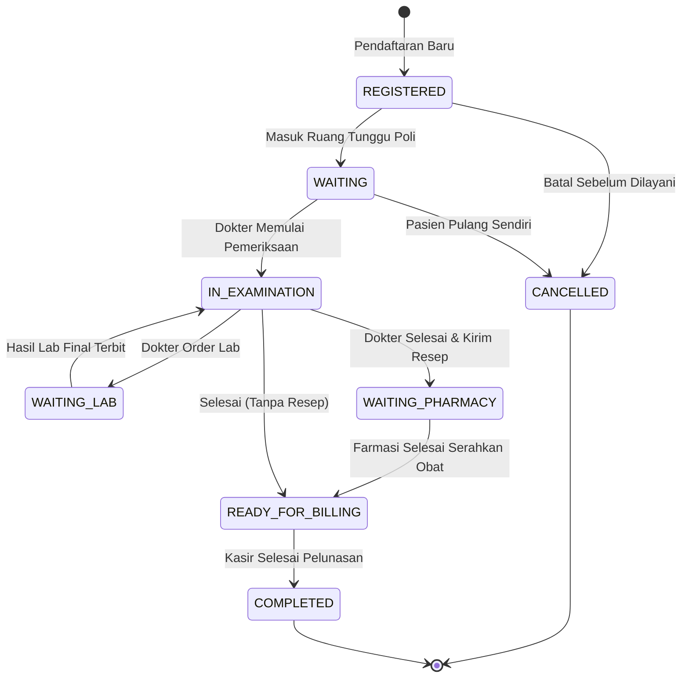
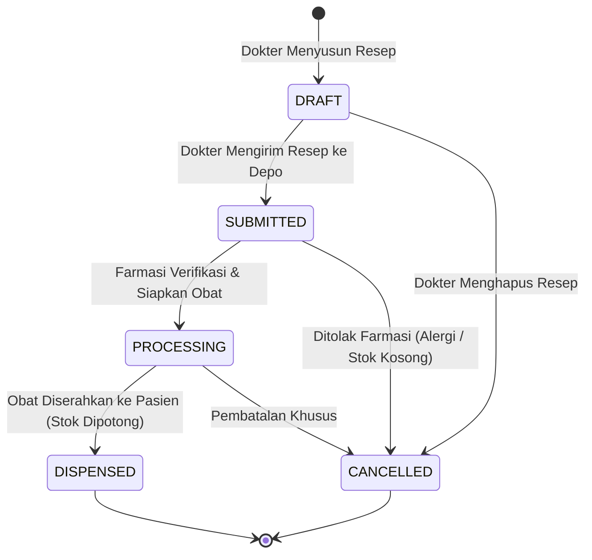
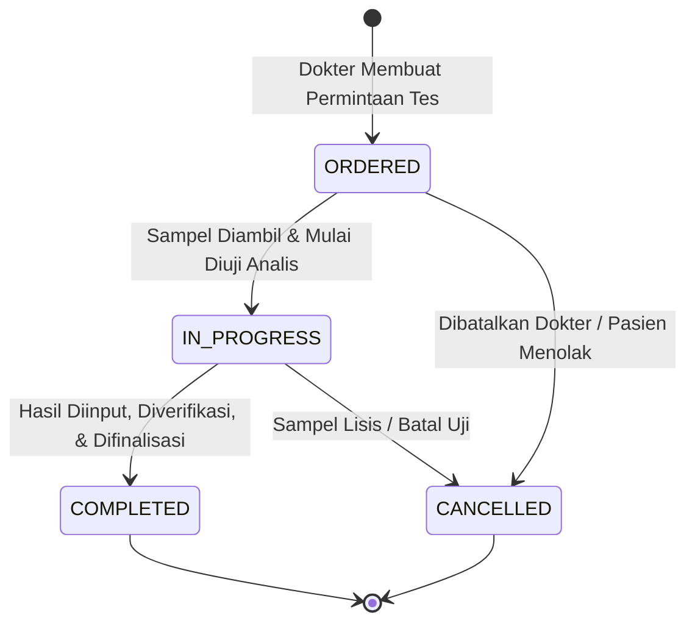
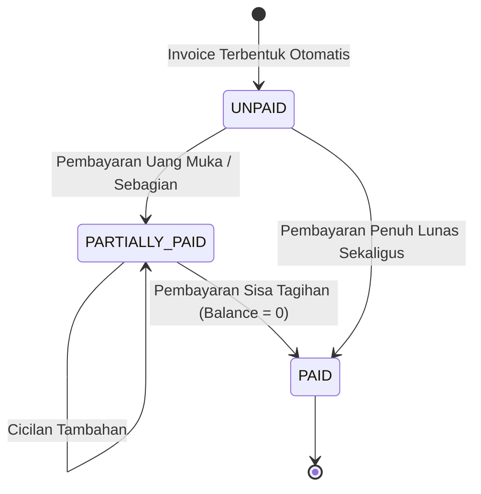

# 04 — State Machines dan Penanganan 6 Masalah Kritis
**SIMRS Rawat Jalan Terintegrasi — PT Inova Medika Solusindo**

---

## 1. Definisi State Machines & Transisi Status

Untuk menjamin konsistensi alur operasional rumah sakit dan mencegah perubahan status secara sewenang-wenang (*illegal state mutation*), sistem menerapkan aturan **Finite State Machine (FSM)** yang ketat pada 4 entitas transaksional utama.

### 1.1 State Machine Kunjungan Pasien (`visits`)



#### Tabel Matriks Transisi Status `visits`:
| Status Awal | Status Tujuan yang Diizinkan | Aktor Berwenang | Kondisi / Trigger |
|---|---|---|---|
| `REGISTERED` | `WAITING`, `CANCELLED` | Petugas Pendaftaran | Pasien hadir di ruang tunggu poli atau dibatalkan |
| `WAITING` | `IN_EXAMINATION`, `CANCELLED`| Dokter / Perawat Poli | Pasien dipanggil masuk ruang praktik dokter |
| `IN_EXAMINATION` | `WAITING_LAB`, `WAITING_PHARMACY`, `READY_FOR_BILLING` | Dokter | Dokter mengirim order lab, atau kirim resep, atau selesai tanpa resep |
| `WAITING_LAB` | `IN_EXAMINATION` | Analis Lab / Dokter | Hasil laboratorium telah difinalisasi dan diverifikasi |
| `WAITING_PHARMACY`| `READY_FOR_BILLING` | Petugas Farmasi | Seluruh obat pada resep telah berhasil diserahkan (*dispensed*) |
| `READY_FOR_BILLING`| `COMPLETED` | Kasir | Seluruh saldo tagihan invoice bernilai Rp 0 (*PAID*) |
| Sembarang (Non-final)| `CANCELLED` | Petugas / Admin | Pembatalan dengan pengisian alasan wajib (*cancel_reason*) |

---

### 1.2 State Machine Resep Obat (`prescriptions`)



**Aturan Emas Farmasi:** Stok obat **hanya boleh berkurang** pada transisi dari `PROCESSING` menuju `DISPENSED`. Jika status dibatalkan setelah dispense, wajib melalui prosedur retur resmi (*CANCELLATION stock movement*).

---

### 1.3 State Machine Permintaan Laboratorium (`lab_orders`)



---

### 1.4 State Machine Tagihan & Invoice (`invoices`)



---

## 2. Penanganan Mendalam 6 Masalah Kritis Sistem

Berikut arsitektur teknis, algoritma database, dan strategi pencegahan untuk 6 skenario kritis enterprise yang diuji dalam studi kasus:

---

### KASUS 1 — Duplikasi Pendaftaran (Race Condition Registration)
**Skenario:** Dua petugas loket secara simultan (dalam milidetik yang sama) mendaftarkan pasien yang sama untuk poliklinik dan tanggal yang sama.

#### 1. Masalah yang Terjadi
Jika hanya mengandalkan pengecekan aplikasi `if (!Visit::find()->where(...)->exists())`, terjadi *time-of-check to time-of-use (TOCTOU) race condition*. Kedua proses lolos validasi dan membuat dua baris antrean terpisah untuk satu pasien.

#### 2. Solusi Arsitektural & Database
1. **Partial Unique Index di PostgreSQL:**
   ```sql
   CREATE UNIQUE INDEX uq_patient_poly_date_active 
   ON visits (patient_id, polyclinic_id, visit_date) 
   WHERE status NOT IN ('CANCELLED');
   ```
2. **Atomic Queue Counter Allocation:**
   Jangan menggunakan `SELECT MAX(queue_number) + 1` karena rentan collision. Gunakan tabel `queue_counters` dengan *atomic upsert / row lock*:
   ```sql
   INSERT INTO queue_counters (polyclinic_id, queue_date, last_number, updated_at)
   VALUES (:poly_id, :date, 1, CURRENT_TIMESTAMP)
   ON CONFLICT (polyclinic_id, queue_date)
   DO UPDATE SET last_number = queue_counters.last_number + 1, updated_at = CURRENT_TIMESTAMP
   RETURNING last_number;
   ```
3. **Response Handling:**
   Jika PostgreSQL melempar `23505 Unique Violation`, Yii menangkap error dan mengembalikan respon standar `409 Conflict`:
   ```json
   {
     "success": false,
     "message": "Pasien sudah memiliki antrean aktif pada poliklinik dan tanggal yang dipilih.",
     "code": "DUPLICATE_ACTIVE_VISIT"
   }
   ```

---

### KASUS 2 — Konkurensi Stok Farmasi (Stock Race Condition)
**Skenario:** Sisa stok obat Paracetamol 500mg tinggal 10 strip. Dua petugas farmasi membuka dua resep berbeda yang masing-masing membutuhkan 10 strip, lalu menekan tombol "Serahkan Obat" pada saat bersamaan.

#### 1. Masalah yang Terjadi
Jika terjadi *blind update* atau pengecekan tanpa lock, kedua transaksi membaca stok `10`, keduanya mengurangi `10`, sehingga stok akhir menjadi `-10` (negatif). Hal ini melanggar integritas inventaris fisik.

#### 2. Solusi Arsitektural & Database
1. **Constraint Database:**
   ```sql
   ALTER TABLE medicine_stocks ADD CONSTRAINT chk_stock_non_negative CHECK (current_stock >= 0);
   ```
2. **Pessimistic Row-Level Locking (`SELECT FOR UPDATE`):**
   Pada Service Layer Yii (`PharmacyDispensationService`):
   ```php
   $transaction = Yii::$app->db->beginTransaction();
   try {
       // Kunci baris stok obat secara eksklusif selama transaksi berlangsung
       $stock = MedicineStock::find()
           ->where(['medicine_id' => $item->medicine_id])
           ->createCommand()
           ->setSql("SELECT * FROM medicine_stocks WHERE medicine_id = :id FOR UPDATE")
           ->bindValue(':id', $item->medicine_id)
           ->queryOne();

       if ($stock['current_stock'] < $item->quantity) {
           throw new InsufficientStockException("Stok tidak mencukupi untuk obat: " . $item->medicine->name);
       }

       // Update stok secara atomik
       Yii::$app->db->createCommand("
           UPDATE medicine_stocks 
           SET current_stock = current_stock - :qty, updated_at = CURRENT_TIMESTAMP 
           WHERE medicine_id = :id AND current_stock >= :qty
       ", [':qty' => $item->quantity, ':id' => $item->medicine_id])->execute();

       // Catat mutasi kartu stok
       StockMovement::record($item->medicine_id, 'DISPENSATION', -$item->quantity, ...);

       $transaction->commit();
   } catch (\Exception $e) {
       $transaction->rollBack();
       throw $e;
   }
   ```

---

### KASUS 3 — Pembayaran Ganda & Gangguan Jaringan (Idempotent Billing)
**Skenario:** Kasir menekan tombol "Bayar Rp 250.000". Jaringan mengalami timeout selama 10 detik. Karena panik, kasir menekan tombol "Bayar" untuk kedua kalinya.

#### 1. Masalah yang Terjadi
Tanpa perlindungan idempotensi, sistem mencatat dua transaksi pembayaran sebesar Rp 250.000. Invoice tercatat *overpaid*, dan kas rumah sakit mengalami selisih fisik vs sistem.

#### 2. Solusi Arsitektural & Database
1. **Idempotency Key Pattern:**
   Frontend React membuat UUID unik (`idempotency_key`) saat formulir kasir dibuka. Key ini dikirim dalam payload atau header `X-Idempotency-Key`.
2. **Database Unique Constraint:**
   ```sql
   ALTER TABLE payments ADD CONSTRAINT uq_payments_idempotency_key UNIQUE (idempotency_key);
   ```
3. **Atomic Balance Lock & Deduplication:**
   ```php
   // Cek apakah key ini sudah pernah diproses sebelumnya
   $existingPayment = Payment::findOne(['idempotency_key' => $key]);
   if ($existingPayment) {
       // Idempotent hit: Kembalikan data pembayaran yang sudah ada tanpa memproses ulang
       return ResponseHelper::success($existingPayment, 'Pembayaran sebelumnya sudah berhasil tercatat');
   }

   $transaction = Yii::$app->db->beginTransaction();
   try {
       // Kunci row invoice
       $invoice = Invoice::find()
           ->where(['id' => $invoiceId])
           ->createCommand()
           ->setSql("SELECT * FROM invoices WHERE id = :id FOR UPDATE")
           ->bindValue(':id', $invoiceId)
           ->queryOne();

       if ($amount > $invoice['outstanding_balance']) {
           throw new InvalidPaymentAmountException("Jumlah pembayaran melebihi sisa tagihan.");
       }

       // Simpan Payment
       $payment = new Payment();
       $payment->idempotency_key = $key;
       $payment->amount = $amount;
       $payment->save();

       // Update sisa tagihan invoice
       Invoice::updateBalance($invoiceId, $amount);

       $transaction->commit();
       return ResponseHelper::success($payment, 'Pembayaran berhasil');
   } catch (\Exception $e) {
       $transaction->rollBack();
       throw $e;
   }
   ```

---

### KASUS 4 — Perubahan Pemeriksaan Pasca-Invoice (Audit & Immutability)
**Skenario:** Tagihan telah terbentuk di kasir, namun dokter tiba-tiba menambahkan tindakan medis baru atau merevisi resep obat.

#### 1. Masalah yang Terjadi
Jika sistem langsung mengubah harga atau menghapus entri master, tagihan yang sudah dicetak atau dibayar sebagian akan menjadi inkonsisten (*dirty financial history*).

#### 2. Solusi Arsitektural
1. **Snapshot Immutability:**
   Tabel `invoice_items` menyimpan `snapshot_price` dan `description` permanen saat invoice dibuat. Perubahan harga master pada `medical_procedures` atau `medicines` tidak akan mempengaruhi invoice historis.
2. **Aturan State Invoice:**
   - **Jika Invoice Masih `UNPAID` dan belum ada pembayaran:** Sistem mengizinkan *Regenerate Invoice* dengan menaikkan atribut `version` (misal: versi 1 ➔ versi 2) dan mencatat riwayat item lama di audit log.
   - **Jika Invoice Sudah Berstatus `PARTIALLY_PAID` atau `PAID`:** Sistem melarang perubahan item historis secara langsung. Penambahan atau pengurangan biaya wajib dicatat melalui entitas **`invoice_adjustments`** dengan menyertakan alasan tertulis dan otorisasi dokter/kepala kasir.

---

### KASUS 5 — Kegagalan Integrasi Layanan (Resilient Node.js & Yii Bridge)
**Skenario:** Node.js menerima hasil uji dari alat laboratorium eksternal, tetapi backend Yii sedang sibuk (*spike traffic*) atau mengalami *temporary network failure*.

#### 1. Masalah yang Terjadi
Hasil lab pasien hilang atau tidak tersimpan ke rekam medis, menyebabkan dokter tidak dapat mendiagnosis pasien.

#### 2. Solusi Arsitektural
1. **Tabel `integration_inbox` pada PostgreSQL:**
   Node.js atau gateway mencatat setiap payload yang masuk dengan status `PENDING` dan `idempotency_key`.
2. **Retry Mechanism with Exponential Backoff:**
   Pada Node.js Express service:
   ```javascript
   async function sendToYiiCore(payload, attempt = 1) {
     const maxAttempts = 4;
     const backoffTimes = [1000, 2000, 4000, 8000]; // 1s, 2s, 4s, 8s
     
     try {
       const response = await axios.post(YII_INTERNAL_LAB_URL, payload, {
         timeout: 5000,
         headers: { 'X-Internal-Secret': process.env.INTERNAL_SERVICE_SECRET }
       });
       return response.data;
     } catch (error) {
       if (attempt < maxAttempts) {
         await new Promise(resolve => setTimeout(resolve, backoffTimes[attempt - 1]));
         return sendToYiiCore(payload, attempt + 1);
       }
       // Simpan ke dead-letter / integration_inbox status FAILED untuk intervensi manual
       await markIntegrationFailed(payload.idempotency_key, error.message);
       throw error;
     }
   }
   ```

---

### KASUS 6 — Performa Sistem & Pencegahan Query N+1
**Skenario:** Pada jam sibuk, ratusan pasien antre di poliklinik. Endpoint daftar antrean memuat data pasien, poli, dan dokter, menimbulkan latensi tinggi.

#### 1. Masalah yang Terjadi
ORM/ActiveRecord mengeksekusi 1 query untuk mengambil 50 kunjungan, ditambah 50 query untuk pasien, 50 query untuk poli, dan 50 query untuk dokter (Total: 151 query SQL = Kasus N+1).

#### 2. Solusi Arsitektural
1. **Wajib Eager Loading di Yii Active Record:**
   ```php
   $visits = Visit::find()
       ->with(['patient', 'polyclinic', 'doctor']) // Hanya 4 query SQL teragregasi
       ->where(['visit_date' => $today])
       ->orderBy(['queue_number' => SORT_ASC])
       ->asArray()
       ->all();
   ```
2. **Database SQL Aggregation untuk Dashboard (Node.js Direct SELECT):**
   Tidak melakukan komputasi matematis di layer aplikasi Node.js. Gunakan agregasi native PostgreSQL yang memanfaatkan index:
   ```sql
   -- Agregasi pendapatan dan status kasir dalam satu tarikan query (O(1) round-trip)
   SELECT 
       COALESCE(SUM(total_amount), 0) AS total_invoiced,
       COALESCE(SUM(paid_amount), 0) AS total_collected,
       COALESCE(SUM(outstanding_balance), 0) AS total_receivables,
       COUNT(id) FILTER (WHERE status = 'PAID') AS count_paid,
       COUNT(id) FILTER (WHERE status = 'UNPAID') AS count_unpaid
   FROM invoices 
   WHERE created_at >= CURRENT_DATE;
   ```
3. **Hasil Benchmark EXPLAIN ANALYZE:**
   - Tanpa Index: `Seq Scan on visits (cost=0.00..850.00 rows=15000 width=128) - Exec: 45.2ms`
   - Dengan Index `idx_visits_date_poly_status`: `Bitmap Index Scan (cost=4.30..15.20 rows=25 width=128) - Exec: 0.8ms` *(Percepatan ~56x)*.
