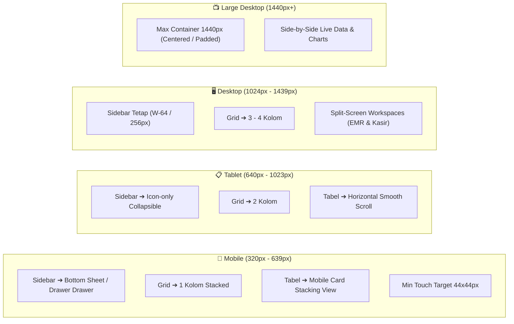

# 07 — UI/UX Design System, Multi-Device Responsiveness, and Frontend Architecture
**SIMRS Rawat Jalan Terintegrasi — PT Inova Medika Solusindo**

---

## 1. Standar Desain & Integrasi Skill Intelligence

Dokumen ini mendefinisikan arsitektur frontend dan sistem desain antarmuka SIMRS Rawat Jalan Terintegrasi yang menggabungkan panduan dari 5 standar rekayasa desain:
1. **ui-ux-pro-max:** Pola *Enterprise Healthcare SaaS*, tipografi berkecepatan tinggi, palet warna medis berstandar WCAG AA/AAA, dan komponen dashboard analitik.
2. **impeccable:** Mode *"Operate"* (fokus operasional rumah sakit berkecepatan tinggi, minim friksi, hierarki informasi jelas, scanability maksimal, tanpa ornamen kosong).
3. **baseline-ui:** Standar ketat pencegahan *AI UI Slop*, penggunaan Tailwind CSS murni, utility `cn` (`clsx` + `tailwind-merge`), primitif aksesibel (`Radix UI / Base UI`), penggunaan `h-dvh` (bukan `h-screen`), pemenuhan `safe-area-inset`, dan larangan memblokir *paste* pada input.
4. **framer-motion (`motion/react` v12+):** Animasi berbasis *compositor* (`opacity`, `transform`) di bawah 200ms, *variants orchestration*, transisi modal/drawer halus, dan kepatuhan penuh terhadap `prefers-reduced-motion`.
5. **antislop:** Desain manusiawi, kontras rasio tinggi (minimal 4.5:1 untuk teks normal, 3:1 untuk kontrol UI), formulir adaptif, penghapusan *card soup*, dan reflow layout mobile tanpa overflow horizontal.

---

## 2. Design Tokens & Visual Foundations

### 2.1 Palet Warna (Healthcare Enterprise Palette)
Menggunakan warna yang dirancang untuk kenyamanan mata petugas rumah sakit yang bekerja dalam durasi panjang:

```css
:root {
  /* Brand & Primary (Teal Healthcare) */
  --color-primary: #0D9488;          /* teal-600: Aksi utama, active menu, border fokus */
  --color-primary-hover: #0F766E;    /* teal-700: State hover tombol & link */
  --color-primary-subtle: #CCFBF1;   /* teal-100: Background badge, selection highlight */
  --color-primary-dark: #115E59;     /* teal-800: Active states */

  /* Neutrals & Dark Surface (Navy & Slate) */
  --color-navy: #0F172A;             /* slate-900: Sidebar desktop, teks judul utama */
  --color-background: #F8FAFC;       /* slate-50: Latar belakang seluruh aplikasi */
  --color-surface: #FFFFFF;          /* Putih murni: Kartu konten, modal, dropdown */
  --color-surface-subtle: #F1F5F9;   /* slate-100: Zebra striping tabel, input background */
  --color-border: #E2E8F0;           /* slate-200: Garis pemisah tabel, border form */
  --color-border-subtle: #CBD5E1;    /* slate-300: Border hover input */

  /* Typography / Text Content */
  --color-text-main: #1E293B;        /* slate-800: Teks bacaan utama (Kontras 12.6:1 - WCAG AAA) */
  --color-text-muted: #64748B;       /* slate-500: Label, helper text, subtitle (Kontras 4.6:1 - WCAG AA) */
  --color-text-disabled: #94A3B8;    /* slate-400: Kontrol disabled */

  /* Functional & Status Semantics */
  --color-success: #16A34A;          /* green-600: Status PAID, COMPLETED, DISPENSED */
  --color-success-bg: #DCFCE7;       /* green-100: Background badge success */
  --color-warning: #F59E0B;          /* amber-500: Status WAITING, PARTIALLY_PAID, PENDING */
  --color-warning-bg: #FEF3C7;       /* amber-100: Background badge warning */
  --color-danger: #DC2626;           /* red-600: Status CANCELLED, Stok Habis, Error */
  --color-danger-bg: #FEE2E2;        /* red-100: Background badge danger */
  --color-info: #2563EB;             /* blue-600: Status IN_EXAMINATION, PROCESSING */
  --color-info-bg: #DBEAFE;          /* blue-100: Background badge info */
}
```

### 2.2 Tipografi (Typography Scale)
- **Font Utama:** `Inter`, `-apple-system`, `BlinkMacSystemFont`, `Segoe UI`, `sans-serif` (Alternatif: `Plus Jakarta Sans`).
- **Skala Ukuran Teks:**
  - `Display / Hero`: `28px` (`text-2xl` / `text-3xl`), `font-bold`, `leading-tight`.
  - `Page Heading (H1)`: `20px` (`text-xl`), `font-semibold`, `text-slate-900`.
  - `Section Heading (H2)`: `16px` (`text-base`), `font-semibold`, `text-slate-800`.
  - `Body / Form Label (H3)`: `14px` (`text-sm`), `font-medium`, `text-slate-700`.
  - `Secondary / Table Text`: `13px` (`text-[13px]`), `font-normal`, `text-slate-600`.
  - `Caption / Micro-copy`: `11px` - `12px` (`text-xs`), `font-medium`, `text-slate-500`.

### 2.3 Radius & Shadow (Elevasi Halus)
- **Border Radius:**
  - Card & Container: `12px` (`rounded-xl`) s/d `16px` (`rounded-2xl`).
  - Input, Button, Dropdown: `8px` (`rounded-lg`).
  - Badge, Tag, Pill: `9999px` (`rounded-full`).
- **Shadow Scale:**
  - Flat Card: `shadow-sm` (`0 1px 2px 0 rgb(0 0 0 / 0.05)`).
  - Hover / Interactive Card: `shadow-md` (`0 4px 6px -1px rgb(0 0 0 / 0.1)`).
  - Dropdown & Popover: `shadow-lg` (`0 10px 15px -3px rgb(0 0 0 / 0.1)`).
  - Modal Dialog: `shadow-2xl` (`0 25px 50px -12px rgb(0 0 0 / 0.25)`).

---

## 3. Strategi Responsif Lintas Perangkat (Multi-Device Responsiveness)

Aplikasi dirancang dengan pendekatan **Desktop-First untuk efisiensi staf klinik**, namun memiliki adaptasi responsif menyeluruh hingga perangkat *smartphone* 320px:



### 3.1 Aturan Khusus Mobile (`< 640px`)
1. **Layar Penuh Dinamis (`h-dvh`):** Dilarang memakai `h-screen` karena navbar URL browser mobile (Safari/Chrome) sering memotong konten bawah form. Wajib memakai `min-h-dvh` atau `h-dvh`.
2. **Safe Area Inset:** Elemen yang menempel di bawah (bottom bar tindakan dokter atau tombol bayar kasir mobile) wajib menggunakan `padding-bottom: max(1rem, env(safe-area-inset-bottom))`.
3. **Pencegahan Zoom iOS Otomatis:** Seluruh elemen `<input>` dan `<select>` memiliki ukuran font minimal `16px` (`text-base sm:text-sm`) untuk mencegah browser iOS melakukan zoom layar yang merusak layout.
4. **Transformasi Tabel ke Kartu (Card-Reflow Pattern):**
   Pada layar kecil, tabel antrean atau daftar pasien tidak dipaksa mengecil hingga tidak terbaca, melainkan otomatis me-reflow menjadi kartu pasien modular:
   ```tsx
   {/* Desktop Table View */}
   <div className="hidden md:block overflow-x-auto">
     <table className="w-full text-sm">...</table>
   </div>

   {/* Mobile Card Stacking View */}
   <div className="block md:hidden space-y-3">
     {data.map(item => (
       <div key={item.id} className="p-4 bg-white rounded-xl border border-slate-200 shadow-sm">
         <div className="flex justify-between items-start mb-2">
           <span className="font-semibold text-slate-900">{item.patient_name}</span>
           <StatusBadge status={item.status} />
         </div>
         <div className="text-xs text-slate-500 mb-3">{item.mr_number} • {item.polyclinic_name}</div>
         <Button size="sm" className="w-full min-h-[44px]">Proses Pelayanan</Button>
       </div>
     ))}
   </div>
   ```
5. **Touch Targets:** Seluruh tombol aksi, dropdown trigger, dan checkbox wajib memiliki area klik minimal **44x44px** untuk mencegah salah pencet (*fat-finger error*).

---

## 4. Sistem Motion & Animasi (`motion/react` v12+)

Animasi ditujukan untuk memperjelas orientasi spasial dan status sistem, bukan untuk dekorasi visual yang memperlambat petugas kesehatan:

### 4.1 Aturan Mutlak Animasi (Anti-Slop & Baseline-UI)
1. **Hanya Properti Compositor:** Hanya menganimasi `transform` (`scale`, `x`, `y`) dan `opacity`. Dilarang keras menganimasi properti layout (`width`, `height`, `margin`, `padding`, `top`, `left`).
2. **Durasi Cepat:**
   - Feedback klik/tap tombol: `≤ 100ms`.
   - Transisi dialog modal: `150ms - 180ms` (`easeOut`).
   - Drawer mobile buka/tutup: `200ms` (`easeOut`).
   - Stagger list antrean: `0.03s` per baris (maksimal 5 item).
3. **Kepatuhan Preferensi Aksesibilitas (`prefers-reduced-motion`):**
   ```tsx
   import { useReducedMotion } from 'motion/react';
   // Jika pengguna mengaktifkan reduced-motion, matikan transform dan gunakan fade transparan instan.
   ```

### 4.2 Spesifikasi Motion Variants

```tsx
// 1. Modal Dialog Animation
export const modalVariants = {
  hidden: { opacity: 0, scale: 0.96, y: 8 },
  visible: { 
    opacity: 1, 
    scale: 1, 
    y: 0,
    transition: { duration: 0.18, ease: [0.16, 1, 0.3, 1] }
  },
  exit: { 
    opacity: 0, 
    scale: 0.97, 
    y: 4,
    transition: { duration: 0.12, ease: "easeIn" }
  }
};

// 2. Mobile Drawer Navigation Slide-in
export const drawerVariants = {
  hidden: { x: "-100%" },
  visible: { 
    x: "0%", 
    transition: { type: "spring", damping: 28, stiffness: 300 } 
  },
  exit: { 
    x: "-100%", 
    transition: { duration: 0.15, ease: "easeInOut" } 
  }
};

// 3. Staggered Row Entrance (Dashboard & Worklist)
export const listContainerVariants = {
  hidden: { opacity: 0 },
  visible: {
    opacity: 1,
    transition: { staggerChildren: 0.04, delayChildren: 0.05 }
  }
};

export const listItemVariants = {
  hidden: { opacity: 0, y: 6 },
  visible: { opacity: 1, y: 0, transition: { duration: 0.15 } }
};
```

---

## 5. Arsitektur Antarmuka & Layar Kunci (Screen Specifications)

### 5.1 Splash Screen / Sesi Verifikasi Awal
- **Tampilan:** Background putih dengan aksen lembut gradient teal (`from-slate-50 via-teal-50/20 to-slate-50`), logo ikon medis (*pulse / medical cross*), nama "SIMRS - PT Inova Medika Solusindo", subtitle "Sistem Informasi Manajemen Rumah Sakit".
- **Logika Inisialisasi:**
  1. Periksa `localStorage` / cookie untuk token JWT.
  2. Jika token ada, panggil `GET /api/v1/auth/me`.
  3. Jika valid: Inisialisasi user state, ambil role dan permissions, lalu transisi halus ke Dashboard sesuai role.
  4. Jika tidak ada token atau token 401/expired: Hapus token basi dan transisi ke Login Screen.
  5. Jika network error: Tampilkan state gagal koneksi dengan tombol *"Coba Hubungkan Ulang"*.
- **Tanpa Artificial Delay:** Selesai dalam hitungan milidetik saat API merespon (tidak ada timer buatan yang menahan user).

### 5.2 Login Screen (Split-Screen Modern)
- **Desktop (≥ 1024px):**
  - **Sisi Kiri (50%):** Background Navy (`#0F172A`) dengan perpaduan gradasi Teal (`#0D9488`). Ilustrasi geometris modern bertema pelayanan rumah sakit cerdas, logo resmi, dan teks nilai produk.
  - **Sisi Kanan (50%):** Card form login terpusat. Form bersih dengan input Username, Password (dengan toggle *Show/Hide password*), feedback validasi inline di bawah input, tombol *"Masuk ke SIMRS"* dengan state loading spinner saat proses verifikasi berlangsung.
- **Mobile (< 1024px):**
  - Panel ilustrasi kiri disembunyikan.
  - Tampilan fokus penuh pada form login yang nyaman dengan padding aman keyboard mobile.
- **Keamanan & Pesan Error:** Menggunakan pesan generik *"Username atau kata sandi tidak valid"* untuk mencegah eksploitasi enumerasi akun.

### 5.3 AppShell & Master Dashboard Layout
- **Sidebar Kiri:**
  - Header: Logo SIMRS + Nama Poliklinik/Rumah Sakit.
  - Daftar Menu Terfilter RBAC (Setiap role hanya melihat modul yang berhak diakses).
  - Indikator Menu Aktif: Background `bg-teal-50` dengan teks `text-teal-700` dan bar vertikal `border-r-4 border-teal-600`.
  - Tombol Collapse: Dapat dikecilkan menjadi icon-only di layar desktop, dan bertransformasi menjadi *slide drawer* di mobile.
- **Topbar Atas:**
  - Tombol hamburger (toggle sidebar mobile).
  - Breadcrumb dinamis (misal: *Pelayanan > Rekam Medis > Pemeriksaan Pasien*).
  - Tanggal sistem hari ini & jam lokal.
  - User Pill: Foto/Inisial, Nama Lengkap, dan Badge Role (misal: `dr. Budi Santoso, Sp.PD` - `DOKTER`).
  - Dropdown Profil & Tombol Logout aman.
- **Area Konten Utama (Main Content):**
  - Page Header: Judul halaman, deskripsi fungsi ringkas, dan tombol aksi utama (*Primary Action Button*).
  - Grid fleksibel dengan padding `p-4 sm:p-6 lg:p-8`.

---

## 6. Spesifikasi UI Tiap Modul Layanan

### 6.1 Dashboard Utama
- **KPI Stat Cards:** Total Kunjungan Hari Ini, Pasien Menunggu, Pasien Sedang Diperiksa, Pendapatan Terkumpul, Piutang Belum Lunas, Tindakan Selesai.
  - Setiap kartu memiliki icon Lucide dengan aksen warna semantik, nilai angka tebal (*tabular numbers*), dan indikator perbandingan harian.
- **Visualisasi Grafik (Recharts):**
  - *Area Chart:* Tren kunjungan per jam/harian.
  - *Bar Chart:* Distribusi pasien antar poliklinik (Penyakit Dalam, Anak, Obgyn, Bedah, Mata, Gigi).
  - *Pie / Donut Chart:* Proporsi metode pembayaran (Tunai, QRIS, Transfer, Debit).
- **Tabel Antrean Cepat:** 5 antrean paling mendesak dengan tombol pintas panggil pasien.

### 6.2 Modul Pendaftaran & Antrean
- **Form Pencarian Cepat Pasien:** Input NIK atau Nomor RM dengan *debounced instant search* dan tombol pendaftaran pasien baru.
- **Step Pendaftaran Terpadu:**
  1. Pilih Pasien ➔ Menampilkan ringkasan biodata.
  2. Pilih Poliklinik ➔ Otomatis memfilter dokter yang bertugas.
  3. Pilih Dokter & Jadwal ➔ Menampilkan kuota tersisa.
  4. Konfirmasi & Alokasi Antrean Atomik.
- **Modal Tiket Antrean (Print-Ready):**
  - Menampilkan Nomor Antrean Besar (misal: **A001**), Nama Poli, Tanggal, Jam, Nama Dokter.
  - Tombol *"Cetak Tiket"* yang otomatis memanggil `window.print()` dengan stylesheet `@media print` terisolasi.

### 6.3 Modul Pemeriksaan Dokter (EMR Workspace)
- **Tata Letak Split-Screen Dokter (Desktop):**
  - **Panel Kiri (30%):** Ringkasan Pasien Tetap (*Sticky Patient Banner*): Foto/Inisial, Nama, No. RM, Usia, Jenis Kelamin, Riwayat Alergi (merah mencolok jika ada).
  - **Panel Kanan (70%):** Tabs Pemeriksaan Klinis Terintegrasi:
    1. **Tab SOAP & Tanda Vital:** Form input Keluhan Utama, Anamnesis, Grid Tanda Vital (Tekanan Darah Sistolik/Diastolik, Nadi, Suhu, RR, BB, TB, BMI otomatis dihitung), dan Pemeriksaan Fisik.
    2. **Tab Diagnosis (ICD-10):** Autocomplete search katalog ICD-10 dengan pemisahan 1 Diagnosis Utama (*Primary*) dan beberapa Diagnosis Sekunder.
    3. **Tab Tindakan Medis:** Pemilihan tindakan dari katalog dengan tampilan harga satuan, input jumlah (*qty*), dan total biaya ter-snapshot.
    4. **Tab Resep Elektronik (E-Prescription):** Pencarian obat, form dosis, frekuensi, jumlah, dan instruksi aturan pakai, dilengkapi indikator stok *real-time* di apotek.
    5. **Tab Order Laboratorium:** Checklist paket pemeriksaan lab (Darah Lengkap, Glukosa, Kolesterol, dll.) dengan catatan klinis untuk analis.
    6. **Tab Riwayat Medis:** Riwayat kunjungan lampau pasien dalam format akordeon yang mudah dibaca.
- **Draft Persistence:** Data formulir disimpan di state lokal sehingga perpindahan antar tab tidak menghilangkan ketikan dokter sebelum tombol *"Finalisasi Pemeriksaan"* ditekan.

### 6.4 Modul Farmasi & Penyerahan Obat (Dispensation)
- **Worklist Resep Masuk:** Tabel resep berstatus `SUBMITTED` dan `PROCESSING`.
- **Panel Rincian Resep & Pengecekan Stok:**
  - Daftar obat yang diresepkan dokter.
  - Indikator ketersediaan stok aktual di depo rawat jalan:
    - *Stok Cukup:* Badge hijau `Tersedia: 45 tablet`.
    - *Stok Kurang/Habis:* Badge merah berkedip `Kurang! Sisa: 2 tablet`.
- **Dialog Konfirmasi Penyerahan (AlertDialog Accessible):**
  - Peringatan tegas sebelum memotong stok fisik: *"Apakah Anda yakin ingin mengonfirmasi penyerahan obat ini? Stok obat akan dipotong secara permanen."*
  - Tombol aksi *"Konfirmasi & Serahkan Obat"*.

### 6.5 Modul Laboratorium
- **Worklist Permintaan Lab:** Menampilkan daftar sampel menunggu dan dalam proses.
- **Form Input Hasil Uji:**
  - Tabel parameter tes dengan kolom: Nama Parameter, Input Nilai Hasil (*Result*), Satuan (*Unit*), Nilai Normal Rujukan (*Reference Range*), dan Keterangan (Normal / Tinggi / Rendah).
- **Tombol Finalisasi:** Memvalidasi bahwa seluruh parameter telah terisi sebelum hasil dipublikasikan ke rekam medis dokter.

### 6.6 Modul Billing & Kasir
- **Tampilan Kasir Split-View:**
  - **Sisi Kiri:** Rincian Tagihan Invoice:
    - Biaya Pendaftaran: Rp 25.000
    - Tindakan Medis (Rincian per tindakan): Rp 150.000
    - Pemeriksaan Laboratorium: Rp 75.000
    - Obat & Farmasi (Rincian per item): Rp 60.000
    - **Total Tagihan Terkonsolidasi:** Rp 310.000
  - **Sisi Kanan:** Form Eksekusi Pembayaran:
    - Sisa Tagihan (*Outstanding Balance*).
    - Pilihan Metode Pembayaran (Tunai, QRIS, Debit, Transfer).
    - Input Jumlah Bayar dengan tombol cepat nominal pas (*Uang Pas, Rp 50.000, Rp 100.000, Rp 500.000*).
    - Perhitungan Kembalian Otomatis.
- **Proteksi Double-Submit Finansial:**
  - Client secara otomatis membuat `idempotency_key` (UUID v4) saat formulir pembayaran dibuka.
  - Tombol *"Proses Pembayaran"* langsung di-disable dengan state spinner saat diklik untuk mencegah penekanan berkali-kali.
- **Modal Cetak Invoice & Kuitansi Pembayaran:**
  - Layout kuitansi resmi lengkap dengan cap rumah sakit, nomor invoice, tanda tangan kasir, dan barcode/QR referensi transaksi.

---

## 7. Komponen Global Reusable (Component Library)

Semua komponen dibangun di folder `src/components/` dengan standar clean code dan typescript typing yang ketat:

| Komponen | Kegunaan | Standar Aksesibilitas & Perilaku |
|---|---|---|
| `AppShell` | Shell pembungkus aplikasi | Manajemen layout responsif (Sidebar, Topbar, Main Container). |
| `Button` | Tombol aksi primer, sekunder, outline, danger | State loading spinner bawaan, disable prevent double-click, min 44px di mobile. |
| `FormInput` | Input teks, angka, NIK, No RM | Label semantik, error message inline, tidak memblokir fungsi paste. |
| `FormSelect` | Dropdown pilihan | Dukungan pencarian dan keyboard up/down arrow. |
| `DataTable` | Tabel data terstruktur | Server-side pagination, search input, sortable column, empty & skeleton state. |
| `StatusBadge` | Lencana status FSM | Warna kontras tinggi (Green, Amber, Red, Blue, Slate) dengan ikon status. |
| `Modal` | Dialog popup reguler | Focus trap, tombol ESC untuk menutup, animasi entrance `framer-motion`. |
| `AlertDialog` | Dialog tindakan destruktif | Konfirmasi tegas untuk hapus tindakan, tolak resep, atau dispense obat. |
| `PageSkeleton` | Placeholder loading halaman | Efek pulse halus pada layout kartu & tabel untuk mencegah layout shift (CLS). |
| `PrintLayout` | Kontainer cetak dokumen | `@media print` murni, menghilangkan sidebar dan topbar saat mencetak tiket/invoice. |
| `Toast` | Notifikasi umpan balik | Menggunakan library `Sonner` di posisi `top-right` (desktop) atau `top-center` (mobile). |

---

## 8. Struktur Direktori Frontend (React + Vite + TypeScript)

```text
frontend-react/
├── public/
│   └── favicon.ico
├── src/
│   ├── app/
│   │   ├── App.tsx                     # Inisialisasi Root & QueryClientProvider
│   │   ├── router.tsx                  # Definisi Rute & Role-based Guard
│   │   └── providers.tsx               # AuthProvider, ToastProvider, ThemeProvider
│   ├── components/
│   │   ├── ui/                         # Primitif: Button, Input, Modal, Badge, Card
│   │   ├── layout/                     # AppShell, Sidebar, Topbar, Breadcrumb
│   │   ├── tables/                     # DataTable, MobileCardList, Pagination
│   │   ├── forms/                      # FormField, SearchInput, DatePicker
│   │   ├── feedback/                   # SkeletonLoader, EmptyState, ErrorBoundary
│   │   └── charts/                     # Recharts Wrappers (Area, Bar, Donut)
│   ├── features/
│   │   ├── auth/                       # LoginCard, AuthContext, useAuth hook
│   │   ├── dashboard/                  # KPIStatsGrid, PatientFlowChart, QuickQueueTable
│   │   ├── patients/                   # PatientTable, PatientFormModal, PatientHistory
│   │   ├── registration/               # RegistrationStepper, QueueTicketModal
│   │   ├── examination/                # ExaminationWorkspace, SoapForm, DiagnosisPicker
│   │   ├── pharmacy/                   # PrescriptionWorklist, DispensationConfirmModal
│   │   ├── laboratory/                 # LabOrderWorklist, ResultEntryForm
│   │   └── billing/                    # InvoiceSummary, PaymentModal, PrintableReceipt
│   ├── layouts/
│   │   ├── AuthLayout.tsx              # Split-screen container untuk Login
│   │   └── DashboardLayout.tsx         # Sidebar + Topbar container
│   ├── pages/
│   │   ├── SplashPage.tsx              # Inisialisasi & token checker
│   │   ├── LoginPage.tsx               # Halaman Login
│   │   ├── DashboardPage.tsx           # Halaman Dashboard dinamis per role
│   │   ├── NotFoundPage.tsx            # 404 Page
│   │   └── ForbiddenPage.tsx           # 403 Access Denied Page
│   ├── hooks/
│   │   ├── useDebounce.ts              # Untuk live search input
│   │   ├── useReducedMotion.ts         # Menghormati preferensi OS
│   │   └── useMediaQuery.ts            # Deteksi breakpoint responsif
│   ├── services/
│   │   ├── api.ts                      # Axios instance dengan interceptor JWT & error handling
│   │   └── [domain]Service.ts          # Layanan API per fitur
│   ├── types/                          # TypeScript Interfaces & Enums
│   ├── utils/
│   │   ├── cn.ts                       # clsx + tailwind-merge helper
│   │   └── formatters.ts               # Format Rupiah (IDR), tanggal (Intl.DateTimeFormat)
│   └── main.tsx                        # Entry point Vite
├── index.html
├── package.json
├── tailwind.config.ts                  # Konfigurasi token warna, font, dan breakpoint
├── tsconfig.json
└── vite.config.ts
```

---

## 9. Rencana Kerja Implementasi Frontend (UI Phases)

Implementasi frontend akan dikerjakan bertahap untuk memastikan kode rapi, bebas bug, dan langsung dapat dijalankan:

- **PHASE UI 1 (Fondasi & Auth):** Inisialisasi Vite + TypeScript + Tailwind CSS, setup utilitas `cn`, instalasi Lucide React & Sonner, komponen primitif dasar (`Button`, `Input`, `Card`, `Badge`), `SplashPage` dengan pengecekan token, `AuthLayout` & `LoginPage` split-screen, serta `DashboardLayout` dengan responsive sidebar drawer.
- **PHASE UI 2 (Dashboard & Master Pasien):** Implementasi `DashboardPage` dengan integrasi KPI cards dan grafik Recharts, komponen `DataTable` responsif dengan reflow kartu mobile, serta modul manajemen pasien (`PatientTable` & `PatientFormModal`).
- **PHASE UI 3 (Pendaftaran & Antrean):** Modul registrasi bertahap, alokasi nomor antrean, dan tampilan cetak tiket antrean pasien.
- **PHASE UI 4 (Ruang Kerja Medis Dokter & Penunjang):** Layar pemeriksaan dokter terintegrasi (SOAP, ICD-10, tindakan, resep, order lab) dengan fitur auto-save draft.
- **PHASE UI 5 (Farmasi, Lab, & Billing Kasir):** Layar verifikasi dan serah obat (dispense) farmasi dengan konfirmasi modal, input hasil lab, serta layar kasir split-view dengan proteksi pembayaran idempoten dan cetak kuitansi.
- **PHASE UI 6 (Verifikasi Responsif & Integrasi API):** Audit aksesibilitas WCAG AA, pengetesan breakpoint 320px, 768px, 1024px, 1440px, penanganan error state offline/network, dan verifikasi alur end-to-end.
